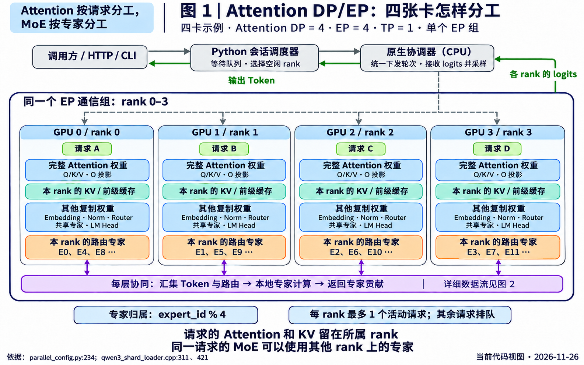
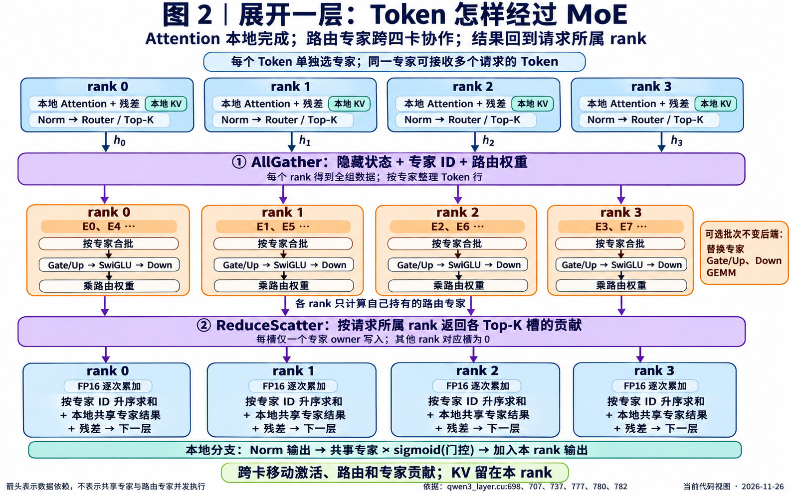
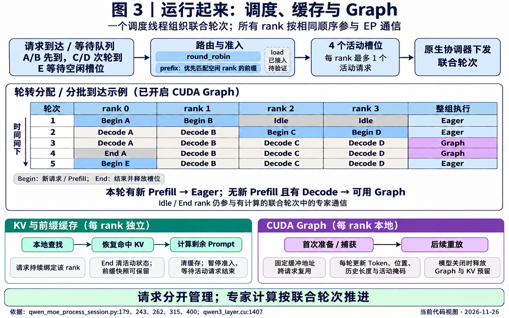

# Attention DP/EP 架构图

Attention 按请求分工，MoE 按专家分工，两者使用同一组 GPU。
这组三张图按“整体分工 → 单层计算 → 调度与资源管理”的顺序阅读。

图中以 Qwen1.5-MoE-A2.7B-Chat、四张 V100、Attention DP=4、EP=4、TP=1 为例：
总共使用四张卡，每张卡独立处理自己的请求，同时为整组请求计算自己持有的专家。
本文说明常规完整推理路径；Prefill/Decode 分离部署及其跨进程 KV 交接不在这组三张图中。

## 1. 整体架构：请求留在本卡，专家分布在四卡

- **请求入口与协调器**：Python 会话组织请求，原生协调器向 worker 下发联合轮次；
  worker 返回各自请求的 logits，协调器在 CPU 采样，再将 Token 返回调用方。
- **每张卡复制的部分**：Embedding、归一化、完整 Attention、路由网络、共享专家和词表投影。
  当前拓扑的 TP=1，Attention 权重没有按 Tensor Parallel 切分。
- **每张卡独有的部分**：本卡请求的活动 KV、前缀快照，以及分配给本卡的路由专家权重。
  专家按 `expert_id % ep_size` 分配；例如 rank 0 持有专家 0、4、8……。
- **两种路由职责不同**：请求路由决定哪个 rank 接收请求；模型内的 MoE 路由决定每个 Token 使用哪些专家。
  请求绑定的 rank 不会因为选中了别卡专家而迁移。

四张卡分别构成四个单卡 Attention 副本，同时组成一个四卡 EP 通信组。
“Attention DP=4、EP=4”描述的是这组卡的两种分工。
当前配置边界为 `attention_dp=ep∈{1,2,4}`、普通 `dp=1`、`tp=1`；
真实模型的四卡验收与单/双卡缩小模型验收应分别看待。

代码定位：拓扑见 [parallel_config.py:245](../../tools/fastllm_pytools/parallel_config.py#L245)，
权重分配见 [qwen3_shard_loader.cpp:319](../../src/distributed/qwen3_shard_loader.cpp#L319)、
[qwen3_shard_loader.cpp:429](../../src/distributed/qwen3_shard_loader.cpp#L429)，
采样与返回见 [moe_generate.cpp:173](../../tools/src/moe_generate.cpp#L173)。
模型与设备验收范围见 [ATTENTION_EP.md:3](../../test/distributed/ATTENTION_EP.md#L3)。

## 2. 单层数据流：本地 Attention，再联合计算专家

1. **本地 Attention**：各 rank 用本卡请求及其 KV 计算 Attention 与残差。
2. **本地路由**：归一化后的隐藏状态进入路由网络，得到 Top-K 专家 ID 和路由权重。
3. **AllGather**：汇集各 rank 的隐藏状态、专家 ID、路由权重，使专家拥有者取得所需输入。
4. **专家计算**：按专家整理 Token，依次计算 Gate/Up、SwiGLU、Down，并乘路由权重。
5. **ReduceScatter**：把结果按请求所属 rank 返回，仍保留每个 Token 的 Top-K 槽位。
   每个槽位只有对应专家的拥有者提供贡献，其他 rank 写零。
6. **本地合并**：按专家 ID 升序，以 FP16 逐项累加路由专家贡献；
   再与经过 sigmoid 门控的共享专家结果、残差合并，进入下一层。

EP 通信传递隐藏状态、路由信息及专家贡献；该路径的 Attention KV 始终留在请求所在 rank。
图中的共享专家分支表示数据依赖，不表示已经与路由专家分支并行执行。
这里的通信实现采用 NCCL AllGather/ReduceScatter。

代码定位：逐层入口见 [qwen3_layer.cu:942](../../src/distributed/qwen3_layer.cu#L942)，
路由与汇集见 [qwen3_layer.cu:732](../../src/distributed/qwen3_layer.cu#L732)，
专家计算见 [qwen3_layer.cu:774](../../src/distributed/qwen3_layer.cu#L774)，
返回与共享专家见 [qwen3_layer.cu:817](../../src/distributed/qwen3_layer.cu#L817)，
有序求和及舍入语义见 [qwen_moe_kernels.cuh:234](../../src/distributed/qwen_moe_kernels.cuh#L234)。

## 3. 运行机制：联合轮次、缓存与 CUDA Graph

### 请求准入与联合轮次

每个 rank 最多有一个活动请求；超过活动槽位数的请求进入等待队列。
一次联合轮次为所有 rank 指定 Begin、Decode、End 或 Idle 动作。
即使某个 rank 没有本地活动请求，只要其他 rank 正在计算，它仍须参与专家计算与通信，
保证整组按相同顺序推进 collective 调用。

图中的时间表使用轮转分配和分批到达：A/B 先进入，C/D 下一轮进入，E 等待空闲槽位。
A 在第 4 轮 End，槽位在该轮完成后释放，E 在第 5 轮 Begin。
这是一个调度示例，不能用来推断所有请求的实际到达顺序。

请求路由有轮转、前缀匹配和负载评分分支。当前代码已接入 `load`，
依据排队数、活动请求和上下文占用评分；默认配置解析也选择 `load`。
图中仍标注“已接入、待验证”，表示接入状态与服务器验收结论需要分开记录。

代码定位：负载评分见 [qwen_moe_process_session.py:179](../../tools/fastllm_pytools/qwen_moe_process_session.py#L179)，
默认策略见 [parallel_config.py:50](../../tools/fastllm_pytools/parallel_config.py#L50)，
联合轮次见 [qwen_moe_process_session.py:262](../../tools/fastllm_pytools/qwen_moe_process_session.py#L262)，
释放槽位见 [qwen_moe_process_session.py:328](../../tools/fastllm_pytools/qwen_moe_process_session.py#L328)。

### KV 与前缀缓存

请求在所属 rank 查找前缀，命中后恢复 KV，再计算剩余 Prompt。
End 结束活动请求，前缀快照可以继续保留；活动请求结束不等于清空全部缓存或释放模型预留显存。
显式清理前缀缓存时暂停新请求准入，等待活动请求排空后执行清理。

因此，“冷缓存”只描述测试开始时的状态；缓存启用时，先准入请求的 Prefill 可以建立前缀快照，
后续准入请求仍可能命中同一轮测试中新建的前缀。

代码定位：前缀恢复见 [qwen3_layer.cu:1452](../../src/distributed/qwen3_layer.cu#L1452)，
快照保存与活动请求结束见 [qwen3_layer.cu:1564](../../src/distributed/qwen3_layer.cu#L1564)，
清理入口见 [qwen_moe_process_session.py:400](../../tools/fastllm_pytools/qwen_moe_process_session.py#L400)。

### CUDA Graph

启用 Graph 时，只要本轮含 Begin，整组走 Eager；本轮没有 Begin 且至少有一个 Decode，
整组走 Decode Graph。End/Idle 可以与其他 rank 的 Decode 同轮出现。

各 rank 首次准备固定地址的缓冲区、预热并捕获，后续更新 Token、历史长度、位置与活动标记后重放。
缓冲区及捕获结果可以跨请求复用。可选专家 GEMM 接入现有捕获与回放流程。

代码定位：路径选择见 [moe_generate.cpp:146](../../tools/src/moe_generate.cpp#L146)，
固定缓冲与元数据更新见 [qwen3_layer.cu:1495](../../src/distributed/qwen3_layer.cu#L1495)，
捕获与回放见 [qwen3_layer.cu:1514](../../src/distributed/qwen3_layer.cu#L1514)。

## 4. 模块职责与实现语言

| 模块 | 实现语言 / 技术 | 职责及调用边界 |
| --- | --- | --- |
| 配置与拓扑 | Python | 解析并校验并行参数，构造 rank 与通信组计划；[parallel_config.py:148](../../tools/fastllm_pytools/parallel_config.py#L148)。 |
| 会话与请求调度 | Python | 管理队列、请求路由、活动槽位、取消和流式结果，构造联合轮次后调用原生协调器；[qwen_moe_process_session.py:262](../../tools/fastllm_pytools/qwen_moe_process_session.py#L262)。 |
| 原生协调器与采样 | C++ | 校验联合动作、选择执行方式、调用进程组，并在 CPU 采样返回 Token；[moe_generate.cpp:143](../../tools/src/moe_generate.cpp#L143)。 |
| 进程通信与 worker | C++ | 编解码轮次协议、下发工作并收集结果，worker 转交执行器；[process_group.cpp:1199](../../src/distributed/process_group.cpp#L1199)、[tp_worker.cpp:712](../../tools/src/tp_worker.cpp#L712)。 |
| 权重加载与专家分配 | C++ | 加载复制权重及本 rank 拥有的专家；[qwen3_shard_loader.cpp:429](../../src/distributed/qwen3_shard_loader.cpp#L429)。 |
| Attention、路由与 MoE | CUDA C++、cuBLAS；可选 CUTLASS SM70 | CUDA kernel 负责算子及打包/合并，线性计算调用相应 GEMM；可选 CUTLASS 只替换路由专家 Gate/Up、Down；[qwen3_layer.cu:774](../../src/distributed/qwen3_layer.cu#L774)、[sm70_expert_gemm.cu:15](../../src/distributed/sm70_expert_gemm.cu#L15)。 |
| EP 通信 | CUDA C++ 主机代码调用 NCCL | 在执行流中提交 AllGather、ReduceScatter，参与层间数据依赖；[qwen3_layer.cu:743](../../src/distributed/qwen3_layer.cu#L743)、[qwen3_layer.cu:819](../../src/distributed/qwen3_layer.cu#L819)。 |
| KV 与 Graph 执行资源 | CUDA C++ 主机代码、CUDA Runtime | 管理设备缓存、前缀恢复、固定缓冲区及捕获/回放；[qwen3_layer.cu:1452](../../src/distributed/qwen3_layer.cu#L1452)、[qwen3_layer.cu:1495](../../src/distributed/qwen3_layer.cu#L1495)。 |

当前会话层的请求调度确实在 Python 中，复用现有服务的请求队列、取消和流式结果接口，
再通过联合轮次协议驱动 C++ 执行端。这里区分其现有职责，不将其描述为已经迁移到 C++；
新增核心逻辑仍遵守项目优先采用 C++ 的规则。

## 5. 实现与验收边界

- 可选批次不变配置目前只接入路由专家 Gate/Up、Down GEMM。
  固定分块不等于把所有请求补到同一最大长度，也不等于已经完成全模型批次不变性。
- 路由、共享专家、Attention、其他投影及 KV/前缀恢复等环节继续复用现有实现，
  需逐步验证；发现并定位差异后再决定修改范围。
- 已记录前缀命中与未命中输出不一致的问题，专家算子或部分无缓存用例通过不能覆盖该问题。
  状态见 [TODO.md:13](../../project/TODO.md#L13)、[TODO.md:105](../../project/TODO.md#L105)。
- 架构图和本说明来自代码检查，不能替代当前版本的服务器编译、功能、准确性和性能验收。
  执行说明及报告约定见 [ATTENTION_EP.md:1](../../test/distributed/ATTENTION_EP.md#L1)。

## 6. 文件与来源记录

| 文件 | 用途 |
| --- | --- |
| [01_overview.png](images/01_overview.png) | 正式图 1：整体架构与四卡分工。 |
| [02_layer_flow.png](images/02_layer_flow.png) | 正式图 2：单层 Attention/MoE 数据流。 |
| [03_scheduler_cache_graph.png](images/03_scheduler_cache_graph.png) | 正式图 3：调度、缓存与 Graph。 |
| [prompts.json](images/prompts.json) | 初次绘图提示词记录，供追溯图意。 |
| [refinements.json](images/refinements.json) | 文字、箭头及布局修订记录，不是额外的正式图。 |
| [sources.json](images/sources.json) | 绘图时的 Git HEAD、源文件位置与哈希，以及三张成图的尺寸和 SHA-256。 |

三张图绘制于 **2026-11-26**，图内页脚行号与来源记录属于当时的代码快照；
绘图时工作区包含未提交改动，因此仅检出来源记录中的 Git HEAD 不足以完全还原当时工作区。
本 README 的实现位置于 **2026-11-27** 按当前代码重新核对。
来源 JSON 保留原始记录，图内历史行号发生偏移时，请使用本文的对应定位。
