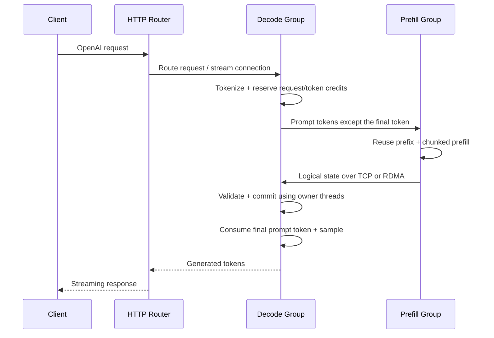

# Fast KV Manager 与 PD 部署

`ftllm router` 管理 P/D 执行组与 HTTP 入口。每个执行组运行一个 `ftllm serve` 进程，可以使用模型已经支持的 TP、attention DP、EP 拓扑；每张 GPU 的模型计算仍由原有持久工作线程负责。网络线程只写独立 staging buffer 或接收端预留且尚未发布的页，不操作活动请求的页表或 CUDA graph。



D 端保留最后一个 prompt token，导入前 N−1 个 token 的状态后重新计算第一个输出。因此采样器、工具约束、输出流只由 D 端负责，不传输 P 端的随机数状态或已采样 token。

## 构建

在正常 FastLLM CUDA 构建参数中添加 `-DFASTKV_RDMA=ON` 即可启用原生 RDMA。没有该选项时仍支持 TCP。独立组件的构建、接口、依赖和测试见 [fastkv/README.md](../fastkv/README.md)。

两端都需要安装包含本次 PD 支持的 FastLLM。P/D 的权重、模型配置和 KV 表示必须兼容；`model_id` 应使用包含 checkpoint revision 的不可变标识，不能只写一个可变的服务别名。当前协议检查该标识、GPU 状态传输协议版本和 adapter 的布局版本，不逐文件计算权重哈希。

## 部署配置

配置文件为 JSON。`command` 是参数数组，不是 shell 字符串；`--pd` 由 router 生成，不要自行放进数组。`endpoint` 是 P 的原生 KV 服务地址，`url` 是 HTTP 就绪检查地址，两者不是同一个端口。以下示例可按模型和显存修改 TP、batch、上下文容量等参数。

仓库提供两份可渲染的配置模板，使用前修改主机、SSH 私钥路径、虚拟环境、模型路径、checkpoint revision 和网卡名：

| 模板 | P 端 | D 端 | 适用范围 |
|---|---|---|---|
| [DeepSeek V4.1](../example/pd/deepseek_v41.json) | 8 卡，TP1/DP8/EP8，最多 16 条 prefill 合批 | 8 卡，TP2/DP4/EP8，最多 64 条请求 | FP4 KV、DSpark 5、fast prefill、262144 上下文 |
| [Naive N0.5](../example/pd/naive_n05.json) | TP4，最多 4 条 prefill 合批 | TP4，最多 4 条请求 | BF16 激活和 KV，关闭 draft，32768 上下文 |

DeepSeek 的 `--tp 8` 表示使用 8 张卡，attention TP 为 `8 / --attn-dp-size`；`--moe_device` 在这 8 卡上分配专家。示例中的容量是配置预算，不是对任意显存容量的保证。需要同时为权重、KV、graph、prefill workspace 和传输暂存留出空间，不能只按总显存除以每 token KV 字节数设置并发。

```bash
cp example/pd/deepseek_v41.json pd.json
# 编辑 pd.json 中的地址、路径、checkpoint 标识和容量后再执行部署
```

`env` 可以给每个执行组设置 `CUDA_VISIBLE_DEVICES`、`PYTHONPATH` 等已有运行参数。`state_dir` 可以单独覆盖。没有 `ssh` 的执行组在控制机本地启动；进程管理目前要求 Linux。SSH 私钥留在控制机，不复制到服务节点。`ingress` 用来指定 HTTP router 所在机器；不配置时在控制机运行。

```bash
ftllm router render --config pd.json
ftllm router start --config pd.json
ftllm router status --config pd.json
curl http://decode-node:8000/health
# 完成后停止本次部署拥有的进程组
ftllm router stop --config pd.json
```

`start` 表示进程已创建，模型仍可能在加载。`status` 区分 `running` 和 `ready`。HTTP `/health` 检查 D 以及它的 P 依赖。部署记录包含 PID、启动时间和 boot ID，停止时核实进程身份，不按进程名称批量终止。

可以配置多个 P 和多个 D。D 默认在所有 P 中根据可恢复前缀与负载选择目标，也可以用执行组的 `prefill` 字段指定 endpoint 子集。HTTP router 负责 D 的队列与会话亲和性，KV 不经过 HTTP router。多个 P 的缓存不共享；查询结果不保证请求接纳时缓存仍然存在。当前静态分配要求某个 D 的全部 P 依赖都在线；不支持运行中自动变更拓扑。

## 调度和线程归属

| 层 | 职责 | 不负责的内容 |
|---|---|---|
| HTTP router | D 的健康检查、排队、流转发、会话亲和性 | token 化、采样、KV 传输 |
| D 调度器 | 请求/token 额度、异步 P 请求、导入成功后允许 decode | 在网络线程中改 GPU 页表 |
| P RPC 工作池 | 校验请求身份、提交计算、发送已就绪结果 | 等待模型 future 或操作模型状态 |
| P 模型执行线程 | 接纳请求、复用前缀、分配 chunk、调用批量前向、发布结果 | 多个 RPC 同时操作同一个模型 |
| GPU 持久工作线程 | 各 rank 的状态恢复、计算和 graph replay | 接收远端指针或远端页号 |
| Fast KV Manager | 有界传输、buffer lease、不可变状态缓存 | 模型算子、分布式 MoE collective |

每个 P 进程只有一个模型执行队列，不是每个 RPC 启动一套 GPU 线程。attention DP 决定请求 KV 的拥有组，组内 TP 决定该请求的计算分片；EP 决定专家分配。`MultiCudaSynchronizeDeviceCallbacks` 在各事件所属设备上等待持久工作线程完成，避免将多卡完成事件串到另一张卡的调用者 stream 上。

P 的单个请求在恢复或导出失败时只返回该请求的错误；批量前向失败时终止该执行队列并唤醒所有等待者，避免继续使用不完整状态。关闭服务时先停止模型执行队列、释放上下文，再停止网络工作池。D 请求取消会释放本地上下文和额度；当前没有按请求向 P 传播取消消息，已提交的远端工作可能完成后被丢弃。

## 状态、缓存与容量

- P 的网络请求先进入同一个模型执行队列。支持 prefill 合批的模型按请求数和总 token 预算合并 chunk，再调用批量前向；每条请求保留独立的位置、KV 和交接结果。未声明合批能力的模型保留单请求前向。DeepSeek V4.1 仅在纯 GPU 模式启用，Naive 使用已有的普通 TP 合批能力。
- P 复用 `--max_batch`、`--prefill_batch_tokens`、`--prefill_batch_requests`、`--prefill_max_requests` 和 `--prefill_max_wait_ms`。 `--max_batch` 还影响模型预分配的请求/前缀状态容量，不等于每次前向的合批数；大并发多轮会话可提高 P 的 `--max_batch`，同时用 `--prefill_max_requests` 限制活动计算请求、`--prefill_batch_requests` 限制目标合批，避免小计算批次把缓存容量也限制得过小。`chunk_tokens` 是每请求每轮上限；按请求依次消耗总 token 预算，尽量保留完整 chunk，未完成请求移到队尾按轮推进，不将预算平分给全部活动请求。P 返回异步结果，计算等待不占通信线程，合批请求数不再受通信 worker 数限制。`--tokens` 同时约束活动 P 请求的总 prompt 长度，未获额度的请求排队。
- 传输线程可在 router 的 `transport.transfer_workers` 中设置，P/D group 的同名字段可覆盖全局值；原生 `--pd` JSON 也支持 `transfer_workers`。取值为 1～64，省略时沿用 `max(4, min(max_batch, 16))`。它控制每个请求/回复方向工作池的 worker 数，不改变 GPU 线程数或模型合批上限。P 的 handler/待发送结果准入上限为 `max_batch`；传输队列由 router 根据关联 D 的 `max_inflight` 推导，接收暂存仍受 `max_inflight_bytes` 约束。线程更多不保证更快，应使用独立 probe 测量。
- P/D 的网络请求和回复分池调度，等待慢 P 计算的 D 请求不占通信 worker，其他 P 的请求及已就绪结果可以继续推进。当前使用静态 peer 列表，D 根据 P 的缓存与负载选择未提交请求的目标，不迁移已在执行的请求；GPU 状态整理、缓存发布和模型导入/导出仍有成本，异步传输不等于 GPU 页池直传。
- 例如 P 的 DP8/TP1/EP8 部署可使用 `--max_batch 16 --chunked_prefill_size 4096 --prefill_batch_tokens 32768 --prefill_batch_requests 8 --prefill_max_requests 16 --prefill_max_wait_ms 2`，并将 P 配置的 `chunk_tokens` 设为 `4096`。只改拓扑或增加网络并发不能替代模型合批。`[FastKV PD] prefill_batch` 日志记录实际进入一次前向的请求数、token 数和前向耗时。
- D 在发起远端 prefill 前预留请求槽位和按 KV 页大小向上取整的 token 额度，避免大量已完成 P 的请求挤占 D 显存。未获额度的请求排队，不分配活动模型 KV。
- 传输只含逻辑状态，不含模型权重、GPU 地址、allocator page ID、graph 或 scratch buffer。数据完整接收并验证后才由模型 adapter 提交。
- P 的 L1 仍复用模型已有 GPU 页池与状态检查点（Naive）；其他 adapter 默认使用总计 1 GiB 的通用 GPU 检查点，可用 `device_cache_bytes` 调整或关闭。在 prefill group 设置 `cache_bytes > 0` 可启用 FastKV 的异步 CPU L2，默认 `0` 关闭。`cache_workers` 控制后台复制线程数，默认 `2`、范围 `[1,64]`。缓存核心不识别模型和 dtype，保存完整检查点及不可变字节区域；Naive 提供页分配版本，使 Full KV 与 indexer 增量备份，SWA 独立保存到同一边界。
- L2 驻留数据使用普通主存，默认每 worker、每使用过的 GPU 仅分配 8 MiB pinned 暂存；线程数增加也会增加这部分预算。备份队列有界，繁忙或容量不足时跳过备份，不阻塞 forward。恢复保留 lease 到 DMA 和消费者全部结束，完整恢复后才由模型线程提交。L1 已覆盖大部分前缀时比较新增命中收益与整段恢复成本，避免为少量尾部 token 做全量 H2D。
- L2 在途总预算取运行时收紧后的 `max_inflight_bytes` 一半，每 GPU 恢复预算取该设备 transport staging 预算一半；两者都独立于 Host 驻留容量。单条检查点不能恢复时不保留这份备份，暂时繁忙则排队重试。路由区分 L1、L2 和重算，已取得 L2 lease 的排队请求只计剩余计算量；GPU token 容量仍按完整请求预留。协议支持向旧 probe 降级。
- L2 当前为每个 P 实例私有，恢复沿用原 PD 表示与 TP 布局；不提供跨 P 共享目录、TP 重分片、量化转换或持久化存储。Host → 私有 GPU message 后仍由现有 adapter scatter 到模型页池，并非直接 DMA 到活动页表。详见 [L2 契约与后续扩展](../fastkv/docs/l2-cache-design.md)。
- `max_inflight_bytes` 限制接收 staging；模型预热后再按每张卡剩余显存的一半收紧 GPU staging 预算，保留余量给计算 workspace。P 导出使用独立的有界 GPU arena 池。暂时没有空闲 arena 时等待 lease 释放，单条状态超过预算则明确报错，不自动回退 CPU。各池独立计费，这不是进程全部显存的总上限；P 缓存额度、D 的 `--tokens` 和 HTTP `max_inflight` 也是不同的限制，不应混淆。
- `ftllm serve` 默认开启模型 verbose 日志；Python API 可用 `model.set_verbose()` 控制。`[FastKV PD] prefix_hit` 记录 P 的前缀复用（未命中为 0），`resident_gpu=1` 表示复用模型 GPU 前缀缓存，此时 FastKV 缓存条目/字节为 0，不代表没有缓存；其他模式记录 FastKV 条目和字节；`handoff_ms` 包含排队、P 计算、打包、传输和导入，不是纯网络耗时。D 保留模型声明支持的 GPU 常驻缓存；对于没有此能力的模型，D 已不使用主存历史恢复，因此也跳过无用的完成请求主存快照。D 的 API `cached_tokens` 当前不把远端 P 命中计入本地缓存统计。`[FastKV PD timing]` 分别记录恢复、记录检查点、导出、发布、释放和导入耗时；累计 `kv_d2h_bytes/kv_h2d_bytes` 只统计 FastKV payload 搬运，不代表模型前向的全部 CUDA 拷贝。
- D 配置多个 P 时，在提交前异步查询各 P 当前可恢复的前缀、待计算 token 和近期 forward 速度，选择目标时同时计入预计完成时间和放弃更长可用前缀产生的额外重算成本，避免为很小的排队收益反复复制大前缀；过载节点仍可分流。查询不复制 KV、不获取页引用，模型页池匹配会刷新命中页的访问顺序；计算准入已满时仍可处理查询；实际恢复必须重新检查状态，查询不预留缓存。D 的有界查询队列和本地在途工作量避免瞬时请求同时涌向同一个 P；单 P 同样查询协议能力，以协商会话元数据和 L2 信息。旧 P 不支持查询或所有查询失败时，退回本地在途工作量最少的节点，实际传输仍使用原有严格校验及错误语义。`[FastKV PD route]` 记录所选 peer、缓存估计、待计算量和是否使用查询回退。
- Naive 的完整 KV 与 SWA 状态需要同时可恢复。每条活动请求仍最多保留三个 prefill 检查点，保留最新边界并分散较早恢复点；整页对齐时在这三个检查点内保留前一页边界以重算 logits。模型把检查点端页注册到各层、各 TP rank 的页池，容量不足时优先回收没有可恢复检查点的闲置后缀，再按 LRU 淘汰；活动页引用仍受保护。普通模型不注册检查点时沿用原页淘汰策略，不增加 GPU 快照槽位或主存 KV 缓存。
- Naive 的 `[Naive prefix cache]` 分别记录完整 KV 页池容量、空闲/可淘汰页和容量淘汰页数，以及窗口快照淘汰、完整 KV 已失效的孤立窗口、同会话旧窗口回收和全部窗口被持有时的分配失败。完整 KV 页计数来自首个完整注意力 K 页池，不重复累计 TP rank、K/V 或层数；窗口计数是 checkpoint 个数。通用 FastKV checkpoint 缓存的容量淘汰由 `cache_evictions` 记录。

L1 和 L2 共用 `[FastKV PD] prefix_hit`，L2 附带 `cache_tier=l2`，只在完整恢复并提交后计数；已有监控可直接统计有效前缀命中。`[FastKV L2 cache]` 单独统计备份、恢复、复用字节与跳过/失败；异步 L2 DMA 不计入同步 `Buffer::Traffic()` 的旧计数。

`forward_ms` 是模型前向调用的 CPU 墙钟耗时，不是 CUDA event 计时；D 的 `Decode Speed` 是解码段内的日志速度，遇到新请求的 Prompt 计算会重新计时。评估端到端吞吐时，应在同一时间窗口对照 P 新计算 token、D 稳态样本和 API 输出 token，不能将日志速度与 API 吞吐的差值直接视为传输耗时。

## 模型接入与当前边界

DeepSeek V4.1 的 adapter 交接窗口、压缩 KV、indexer、未完成的压缩 tail 和 Engram 历史；共享 KV 的源层只导出一次。Attention DP/TP 的分组可与 P 不同，由 D 的模型执行器恢复到本地拥有者。

Attention DP 模式在导入阶段分配请求归属，由对应 GPU 的持久线程恢复本地 KV；导入完成不会推进 token 位置。请求进入 decode 批次前已经具备整图需要的窗口和压缩状态，不需要先执行一次逐层前向。大于 8 行的不规则普通 decode 批次可以匹配已预热的更大整图：按各 attention group 的行数补齐，补齐行只使用预热时保留的私有 KV，执行后回退其元数据，不推进真实请求。没有适用图时仍保留普通前向回退。分组同时考虑 KV 长度与请求数，避免短请求集中后超过已预热图的行容量；本地前缀恢复复用相同的准备路径。

Naive N0.5 的 adapter 交接各 TP rank 的逻辑 KV、完整注意力的分页内容和滑窗的时间顺序。远端页号不会直接用作本地页号。支持 BF16、FP8 和 FP4 KV，以及 replicated/layer_shard Indexer；FP4 的独立 FP8 Indexer 随主 KV 一起传输，payload 和 scale 均按原字节恢复，不重新量化。TP 交接统一使用 v3 布局。

Naive 部署使用 [Naive 模板](../example/pd/naive_n05.json)，两端保持一致的 TP、激活、KV dtype 和 Indexer 配置。使用 FP4 时，两端将 `--kv_cache_dtype` 设为 `fp4`，保持 BF16 计算、TP >= 2、关闭 draft。Naive 支持 P 使用普通 GPU KV、D 使用 KVMem 的异构存储部署。Indexer context sharding、P 端 KVMem、KVMem 与 PD draft 同时启用，以及 P/D 不同 TP 或 KV 精度仍明确拒绝。

### Naive：GPU prefill → KVMem decode

P 保持原来的纯 GPU 参数；仅在 D 的 `command` 中增加 `--kvmem`，并在它之前设置 `--max_batch`。例如：

```sh
--tp 4 --ep 4 --max_batch 256 --tokens 16777216 \
--atype bfloat16 --kv_cache_dtype fp8_e4m3 \
--indexer_dtype fp8 --indexer_tp_storage layer_shard --dspark 0 \
--max_context_length 200000 \
--kvmem '{"max_tokens":200000,"resident_tokens":4096,"prefill_tokens":4096,"host_mib":196608}'
```

此处容量只是配置示例，启动时仍按实际模型检查主存、完整 GPU Indexer、热 KV、SWA 和工作区预算。`--tokens` 是共享物理 token 池，`max_tokens` 是每请求长度上限；二者独立。D 的 `max_inflight` 应与所需请求上限一致。两端保持同一模型、TP、KV dtype 和 Indexer 配置，D 的 KVMem 只改变存储位置，不改变 DSA TopK 或量化字节。

状态按原字节导入，但 KVMem 与普通 GPU 分页使用各自的注意力执行路径，不承诺两种后端的逐 token 贪婪输出一致。导入正确性需要与同一 KVMem 后端直接构建的状态对照，跨后端的数值一致性另行评估。

Naive TP 使用 v3 状态表示，将主 KV、Indexer 和 SWA 分开传输。两端需使用支持 v3 的版本；旧版本因布局标识不一致而拒绝交接。纯 GPU → 纯 GPU 仍使用原 GPU 页池，导入时重建其本地 packed K/Indexer 布局。

D 在模型调度线程中预留私有主存页及对应 Indexer 页，随后发起 P 请求。RDMA 将完整 DSA K/V 直接写入 KVMem 的 pinned 主存页、Indexer 直接写入 GPU 页；TCP 沿用相同目标描述，但 GPU 数据需要 TCP 的主机中转。SWA 接收到有界 GPU 暂存，提交时复制到请求的环形窗口。完整主 KV 不在 D 建立 GPU 中转副本，也不复制 P 的热缓存；D 按原有 TopK 精确装入自己的热 KV。

网络完成后，模型线程绑定请求槽、重置热缓存映射、发布固定地址页表并恢复 SWA，全部完成才允许 decode。传输和返回结果持有页租约；错误或取消必须等 I/O 完成或 QP 销毁后才能归还页。容量不足时排队，不提前回收在途页。P 的 GPU 前缀缓存和 FastKV L2 继续使用已有机制，D 的活动 KVMem 主存池与 P 的 L2 是不同预算。

回归入口：`naive_n05_pd_*` 和 `naive_n05_pd_kvmem_*`；后者覆盖 BF16/FP8/FP4、两种 Indexer 存储、页边界、超过热缓存长度的历史及导入后的 eager/Graph 解码。独立传输测试 `fastkv_receive_target_test [--rdma [GPU]]` 检查分段写入、Host/CUDA 落点、非法描述拒绝和租约回收。

当前部署路径支持文本请求。多模态 PD 需要继续补充媒体身份与状态 adapter，目前明确拒绝，不能通过仅传 token 冒充多模态交接。DeepSeek 可开启 DSpark 5。当前只有单请求路径执行草稿和验证；多请求批次先排出已接受 token，随后使用普通 target decode，丢弃不能继续使用的草稿状态。请求回到单请求路径后从当前 target 边界重建草稿窗口。P 的中间 prefill 不生成候选；P/D 的 DSpark 开关需要保持一致。

Naive 纯 GPU PD 支持 DSpark，包括单卡草稿、完整草稿 TP 和仅 MLP TP，以及 D 端合批、Graph、贪婪与 rejection sampling。P/D 都配置相同的 `--draft <草稿模型目录>`、`--dspark 5`，并在节点 `env` 中设置相同的 `FASTLLM_DSPARK_TP`（例如 `4` 或 `mlp:4`）；主模型需使用 BF16/FP8 KV。草稿 TP 使用主模型 TP 的前 N 个 rank，N 不超过主模型 TP。`model_id` 应同时标识 target 与 draft 检查点。

草稿状态使用 `draft-v2` 布局：按逻辑 rank 传输已提交窗口的 K/V 和前缀检查点所需的归一化输入尾部。D 复用本地草稿缓冲区，预留候选空间后才允许执行；采样队列和 Graph 不跨节点传输。两端草稿结构、TP 大小及分片策略必须一致，旧草稿布局或不兼容配置会在交接前被拒绝。不启用 DSpark 时不附加草稿状态。

GPU 状态在协议中携带逻辑 rank，由接收方映射到本地 GPU；网络线程只写私有 staging 或接收端预留的目标区，完成 RDMA 可见性处理后交给模型拥有者。Naive 在拥有者 stream 上批量整理/恢复页和滑窗，避免逐页 CUDA API 调用以及额外的导入副本。小 buffer 合并到有界 arena，复用内存、MR 和连接。纯 GPU 的 RDMA 路径不经主存 KV；KVMem 定向接收按上述规则直达预留页，TCP 兼容路径仍经主存分块搬运。普通 GPU 接收仍需从 staging 恢复到本地页池；当前各路径仍有状态整理、完整状态传输和导入结束同步，尚不支持增量交接。

新增模型需要实现 `PDLayout`、`ExportPDState`、`ImportPDState`；多 GPU adapter 用 `PDDevices` 声明逻辑 rank 的设备顺序。可选的 `HasPDResidentPrefixCache` 只应用于确实支持 GPU 常驻恢复的模型，未实现时使用通用检查点缓存。接入测试应覆盖全量交接、前缀续接、页边界、并发、取消和错误布局测试。逻辑分片规划独立于通信后端；未来多机 wide-EP 的进程组与 collective 属于计算层，需要单独接入，不能仅靠增加 router 的 D 节点来替代。

## 部署检查与排障

1. 两端使用同一版本的 FastLLM；核对 checkpoint、激活 dtype、KV dtype 和影响状态语义的参数。DeepSeek 的 `--fast_prefill` 是近似 bounded replay，不是无损缓存开关；模板在两端统一启用，做正确性对比时单节点参考也应使用相同的 prefill 策略。目前 layout 字符串不编码该策略，不能把标识相同视作计算语义也完全相同。
2. 先运行 `router render` 检查生成的 `--pd`。普通网络使用 `transport.type=tcp`；RDMA 使用 `rdma` 并核对两端可达的控制端口、RoCE/IB 配置和网卡名。严格 RDMA 不会在失败后自动改用 TCP。
3. `router start` 后持续检查 `router status`，直到 P、D 和 router 均 ready。直接访问 P 的 HTTP API 会绕过 PD 路由，客户端应使用 router 地址。
4. 做短请求、续接前缀、并发请求和工具调用检查，再开始长任务。OpenAI 请求示例：

   ```bash
   curl http://decode-node:8000/v1/chat/completions \
     -H 'Content-Type: application/json' \
     -d '{"model":"deepseek-v41","messages":[{"role":"user","content":"Reply OK."}],"max_tokens":32,"stream":false}'
   ```

5. 用 `GET /deploy/status` 查看各 D 的 active/queued；它们是 HTTP 请求数，不是 GPU decode batch。P 的 `prefill_batch` 才是实际前向合批数，D 的 decode 日志才反映已经提交 KV 的运行请求。首次加载、图预热和首批 P 排队不应计入稳态 decode 速度。
6. 当前部署日志位于各执行组 `state_dir/service.log`。缓存命中看 P 的 `prefix_hit`；不能只用 D 的 API 缓存计数判断 P 是否命中。容量不足时分别检查 P 活动 token 池、P 缓存、D 请求/token 额度和接收 staging，不能把所有等待都归因于 GPU 前向。

部署模板只使用正式参数和已有的 GPU/graph 开关，不依赖探针、注入脚本、临时启动包装器或调试环境变量。`ftllm router` 的 Python 控制面使用现有 FastLLM/aiohttp 环境；独立 Fast KV Manager 数据面仍为 C++，不依赖 Python。

## 回归入口

- 独立组件：按 [Fast KV Manager](../fastkv/README.md) 运行 CTest，覆盖协议边界、缓存不可变性、读取 lease、淘汰、增长、分支、并发与 TCP 传输。
- 通用 PD 调度：启用 `UNIT_TEST` 后运行 `pd_state_test`，覆盖变长合批、前缀恢复、额度、异常和停止时的上下文释放。
- DeepSeek：`deepseekV41DsparkBatchRegression TP_FIXTURE_DIR 4 fp4 64 balanced`，fixture 由 `test/basic/test_deepseek_v41_tp_graph.py` 的 `prepare()` 生成。测试通过独立 eager 结果与实际 CUDA launch 次数检查不规则批量、PD 导入、私有补齐行和从 batch 回到单请求；需要 8 张空闲 CUDA GPU，不作为无条件 CTest。
- Naive：`naive_n05_verify_graph_test 2 batch_prefill_nosample`，检查不采样的批量 prefill 后 decode 结果。该入口需要 `FASTLLM_TEST_VERIFY_GRAPH_HOOKS`，普通 `naive_n05_tp_model_test` 不包含此模式。
- Naive 状态交接：`ctest --test-dir build -R '^naive_n05_pd_' --output-on-failure`，需要 4 张空闲 CUDA GPU，覆盖 BF16/FP8/FP4、replicated/layer_shard Indexer、页边界、滑窗回绕以及 eager/Graph 导入后 logits 一致性；不替代双机传输测试。
- 部署控制：`python -m unittest discover -s test -p test_pd_router.py`，检查参数生成和 P 依赖健康检查；两份示例另用 `ftllm router render --config example/pd/<模板>.json` 验证。

### 路由、缓存和排队的职责

请求可通过 `X-Session-Id`（优先）或 `X-SMG-Routing-Key` 提供最多 512 字节的会话标识。
会话标识只用于路由，不赋予 KV 或 SWA 快照额外的淘汰优先级；缓存恢复仍校验
实际 token、模型布局、页 generation 及配套状态。无会话标识的请求使用相同缓存规则。
多模态请求仍遵循已有的缓存隔离规则。

缓存只有两种所有权：正在使用的状态由请求持有，空闲历史按 LRU 淘汰。
Naive 复用完整 KV 页引用与 GPU SWA 检查点，优先回收不能恢复的尾部；
请求持有的共享快照不可覆盖，最后一个引用释放后才允许回收。
不为已完成会话单独保留永久保底点，也不维护另一套会话缓存索引。

P 的请求按以下生命周期推进，只有模型执行线程创建和释放 GPU 状态：

| 状态 | 缓存所有权 | 预算与处理 |
|---|---|---|
| RPC 等待 | 无；路由探测只读元数据 | 按完整输入计入待处理工作，避免把可能失效的命中当成已完成工作 |
| 已准备 | 恢复并持有完整 KV 与配套状态，尚未执行 forward | 按完整最终 prompt、向上取整到 KV 页预留 token；此队列最多占总 token 容量的一半 |
| 正在执行 | 继续使用同一个请求上下文 | 与已准备请求共享总 token 容量和 `max_batch` 上限；forward 并行数另受 `prefill_max_requests` 约束 |
| 完成或取消 | 释放请求引用 | 完成状态可转为空闲历史；取消、异常和停机复用同一释放路径 |

等待请求按到达顺序准入；活跃请求的 chunk 轮转执行。已准备请求优先补入执行队列，
再准备新的等待请求。准入为完整 prompt 预留空间，避免保留命中前缀后却无法完成新增 token。
预备额度由现有总 token 容量导出，不增加环境变量或部署参数。仅使用原生驻留前缀缓存
的模型启用提前准备；其他 adapter 保持原批处理与缓存行为。超大请求不能提前准备时，
仍可在执行额度释放后正常准入。此机制缩短排队期间的缓存失效窗口，但不保证超出预算
的等待请求或长期空闲会话必然命中。

多个 P/D 使用有界 `SessionDirectory` 传播已提交的归属。新会话用确定性映射和负载
选择 P；已建立的归属计入前缀重建成本，并按重建时间判断持续过载，减少瞬时负载波动
造成的搬迁。持续明显过载、节点不可用，或原 P 已丢失前缀而另一 P 可恢复时允许转移。
D 成功导入后才公布新归属；通知只更新路由提示，不删除 KV，也不改变模型缓存策略。
版本号和端点排序使并发、迟到通知收敛；异步通知有界重试，目录淘汰或通知失败不影响
计算正确性。这不是分布式锁或持久化共识。旧 P 经能力协商继续使用原协议，
不因提示不受支持而重试已执行的 prefill。
