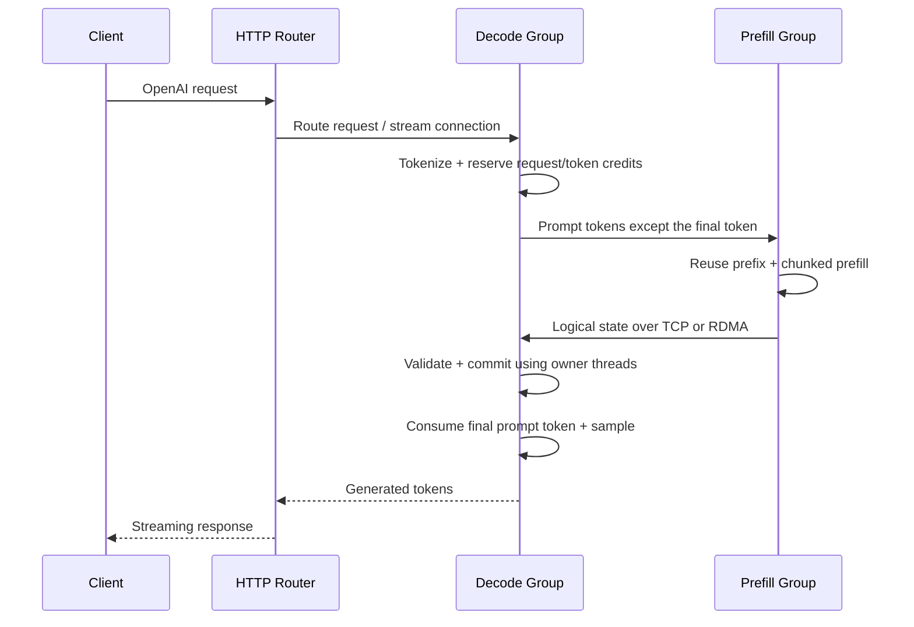

# Fast KV Manager 与 PD 部署

`ftllm router` 管理 P/D 执行组与 HTTP 入口。每个执行组运行一个 `ftllm serve` 进程，可以使用模型已经支持的 TP、attention DP、EP 拓扑；每张 GPU 的模型计算仍由原有持久工作线程负责。网络线程只管理独立 staging buffer，不操作活动请求的页表或 CUDA graph。



D 端保留最后一个 prompt token，导入前 N−1 个 token 的状态后重新计算第一个输出。因此采样器、工具约束、输出流只由 D 端负责，不传输 P 端的随机数状态或已采样 token。

## 构建

在正常 FastLLM CUDA 构建参数中添加 `-DFASTKV_RDMA=ON` 即可启用原生 RDMA。没有该选项时仍支持 TCP。独立组件的构建、接口、依赖和测试见 [fastkv/README.md](../fastkv/README.md)。

两端都需要安装包含本次 PD 支持的 FastLLM。P/D 的权重、模型配置和 KV 表示必须兼容；`model_id` 应使用包含 checkpoint revision 的不可变标识，不能只写一个可变的服务别名。当前协议检查该标识和 adapter 的布局版本，不逐文件计算权重哈希。

## 部署配置

配置文件为 JSON。`command` 是参数数组，不是 shell 字符串；`--pd` 由 router 生成，不要自行放进数组。`endpoint` 是 P 的原生 KV 服务地址，`url` 是 HTTP 就绪检查地址，两者不是同一个端口。以下示例可按模型和显存修改 TP、batch、上下文容量等参数。

仓库提供两份可渲染的配置模板，使用前修改主机、SSH 私钥路径、虚拟环境、模型路径、checkpoint revision 和网卡名：

| 模板 | P 端 | D 端 | 适用范围 |
|---|---|---|---|
| [DeepSeek V4.1](../example/pd/deepseek_v41.json) | 8 卡，TP1/DP8/EP8，最多 16 条 prefill 合批 | 8 卡，TP2/DP4/EP8，最多 64 条请求 | FP4 KV、DSpark 5、fast prefill、262144 上下文 |
| [Naive N0.5](../example/pd/naive_n05.json) | TP4，最多 4 条 prefill 合批 | TP4，最多 4 条请求 | BF16 激活和 KV，关闭 draft，32768 上下文 |

DeepSeek 的 `--tp 8` 表示使用 8 张卡，attention TP 为 `8 / --attn-dp-size`；`--moe_device` 在这 8 卡上分配专家。示例中的容量是配置预算，不是对任意显存容量的保证。需要同时为权重、KV、graph、prefill workspace 和传输暂存留出空间，不能只按总显存除以每 token KV 字节数设置并发。

```bash
cp example/pd/deepseek_v41.json pd.json
# 编辑 pd.json 中的地址、路径、checkpoint 标识和容量后再执行部署
```

`env` 可以给每个执行组设置 `CUDA_VISIBLE_DEVICES`、`PYTHONPATH` 等已有运行参数。`state_dir` 可以单独覆盖。没有 `ssh` 的执行组在控制机本地启动；进程管理目前要求 Linux。SSH 私钥留在控制机，不复制到服务节点。`ingress` 用来指定 HTTP router 所在机器；不配置时在控制机运行。

```bash
ftllm router render --config pd.json
ftllm router start --config pd.json
ftllm router status --config pd.json
curl http://decode-node:8000/health
# 完成后停止本次部署拥有的进程组
ftllm router stop --config pd.json
```

`start` 表示进程已创建，模型仍可能在加载。`status` 区分 `running` 和 `ready`。HTTP `/health` 检查 D 以及它的 P 依赖。部署记录包含 PID、启动时间和 boot ID，停止时核实进程身份，不按进程名称批量终止。

可以配置多个 P 和多个 D。D 默认轮转使用所有 P，也可以用执行组的 `prefill` 字段指定 endpoint 子集。HTTP router 负责 D 的队列与会话亲和性，KV 不经过 HTTP router。P 选择目前是 D 内部轮转，不是按前缀命中或实时负载路由；多个 P 的缓存也不共享。当前静态分配要求某个 D 的全部 P 依赖都在线；不支持运行中自动变更拓扑。

## 调度和线程归属

| 层 | 职责 | 不负责的内容 |
|---|---|---|
| HTTP router | D 的健康检查、排队、流转发、会话亲和性 | token 化、采样、KV 传输 |
| D 调度器 | 请求/token 额度、异步 P 请求、导入成功后允许 decode | 在网络线程中改 GPU 页表 |
| P RPC 工作池 | 校验请求身份，等待对应 future，发送完整状态 | 持有模型锁等待其他请求到达 |
| P 模型执行线程 | 接纳请求、复用前缀、分配 chunk、调用批量前向、发布结果 | 多个 RPC 同时操作同一个模型 |
| GPU 持久工作线程 | 各 rank 的状态恢复、计算和 graph replay | 接收远端指针或远端页号 |
| Fast KV Manager | 有界传输、buffer lease、不可变状态缓存 | 模型算子、分布式 MoE collective |

每个 P 进程只有一个模型执行队列，不是每个 RPC 启动一套 GPU 线程。attention DP 决定请求 KV 的拥有组，组内 TP 决定该请求的计算分片；EP 决定专家分配。`MultiCudaSynchronizeDeviceCallbacks` 在各事件所属设备上等待持久工作线程完成，避免将多卡完成事件串到另一张卡的调用者 stream 上。

P 的单个请求在恢复或导出失败时只返回该请求的错误；批量前向失败时终止该执行队列并唤醒所有等待者，避免继续使用不完整状态。关闭服务时先停止模型执行队列、释放上下文，再停止网络工作池。D 请求取消会释放本地上下文和额度；当前没有按请求向 P 传播取消消息，已提交的远端工作可能完成后被丢弃。

## 状态、缓存与容量

- P 的网络请求先进入同一个模型执行队列。支持 prefill 合批的模型按请求数和总 token 预算合并 chunk，再调用批量前向；每条请求保留独立的位置、KV 和交接结果。未声明合批能力的模型保留单请求前向。DeepSeek V4.1 仅在纯 GPU 模式启用，Naive 使用已有的普通 TP 合批能力。
- P 复用 `--max_batch`、`--prefill_batch_tokens`、`--prefill_batch_requests`、`--prefill_max_requests` 和 `--prefill_max_wait_ms`。`chunk_tokens` 是每请求每轮上限，总预算不足时会给多条请求分配更小的 chunk；长请求按轮推进。当前原生服务最多有 16 个请求处理线程，因此一次 P 合批最多接入 16 条请求。`--tokens` 同时约束活动 P 请求的总 prompt 长度，未获额度的请求排队。
- 例如 P 的 DP8/TP1/EP8 部署可使用 `--max_batch 16 --chunked_prefill_size 4096 --prefill_batch_tokens 32768 --prefill_batch_requests 8 --prefill_max_requests 16 --prefill_max_wait_ms 2`，并将 P 配置的 `chunk_tokens` 设为 `4096`。只改拓扑或增加网络并发不能替代模型合批。`[FastKV PD] prefill_batch` 日志记录实际进入一次前向的请求数、token 数和前向耗时。
- D 在发起远端 prefill 前预留请求槽位和按 KV 页大小向上取整的 token 额度，避免大量已完成 P 的请求挤占 D 显存。未获额度的请求排队，不分配活动模型 KV。
- 传输只含逻辑状态，不含模型权重、GPU 地址、allocator page ID、graph 或 scratch buffer。数据完整接收并验证后才由模型 adapter 提交。
- 通过 router 部署时，P 默认保留最多 1 GiB 的主存前缀状态，使用 `cache_bytes` 修改，设为 `0` 可关闭。不同前缀版本共享相同的不可变数据块，按唯一数据块和 checkpoint 元数据计费，不再默认限制为 256 个完整快照。完整命中直接交付；部分命中在已保存的准确边界恢复状态后继续 prefill。已有读取 lease 在缓存淘汰后仍有效；活动请求恢复出的连续副本属于额外临时内存。
- `max_inflight_bytes` 限制接收 staging；P 缓存额度、D 的 `--tokens` 和 HTTP `max_inflight` 是不同的限制，不应混淆。
- `ftllm serve` 默认开启模型 verbose 日志；Python API 可用 `model.set_verbose()` 控制。`[FastKV PD] prefix_hit` 记录 P 的前缀复用（未命中为 0），同时记录条目数、实际缓存字节和未共享时的逻辑字节；`handoff_ms` 包含排队、P 计算、打包、传输和导入，不是纯网络耗时。D 的 API `cached_tokens` 当前不把远端 P 命中计入本地缓存统计。

## 模型接入与当前边界

DeepSeek V4.1 的 adapter 交接窗口、压缩 KV、indexer、未完成的压缩 tail 和 Engram 历史；共享 KV 的源层只导出一次。Attention DP/TP 的分组可与 P 不同，由 D 的模型执行器恢复到本地拥有者。

Attention DP 模式在导入阶段分配请求归属，由对应 GPU 的持久线程恢复本地 KV；导入完成不会推进 token 位置。请求进入 decode 批次前已经具备整图需要的窗口和压缩状态，不需要先执行一次逐层前向。大于 8 行的不规则普通 decode 批次可以匹配已预热的更大整图：按各 attention group 的行数补齐，补齐行只使用预热时保留的私有 KV，执行后回退其元数据，不推进真实请求。没有适用图时仍保留普通前向回退。分组同时考虑 KV 长度与请求数，避免短请求集中后超过已预热图的行容量；本地前缀恢复复用相同的准备路径。

Naive N0.5 的 adapter 交接各 TP rank 的逻辑 KV、完整注意力的分页内容和滑窗的时间顺序。远端页号不会直接用作本地页号。当前要求 P/D TP 大小一致；稀疏/offload KV、indexer context sharding 和 draft TP 会明确拒绝。

Naive 部署使用 [Naive 模板](../example/pd/naive_n05.json)，两端保持一致的 TP、激活和 KV dtype。

当前部署路径支持文本请求。多模态 PD 需要继续补充媒体身份与状态 adapter，目前明确拒绝，不能通过仅传 token 冒充多模态交接。DeepSeek 可开启 DSpark 5。当前只有单请求路径执行草稿和验证；多请求批次先排出已接受 token，随后使用普通 target decode，丢弃不能继续使用的草稿状态。请求回到单请求路径后从当前 target 边界重建草稿窗口。P 的中间 prefill 不生成候选；P/D 的 DSpark 开关需要保持一致。Naive 的 draft TP 暂不支持，使用 `--dspark 0`。

当前模型导入使用主存 staging 后由 GPU 拥有者恢复；传输组件具备 GPUDirect buffer 能力，但这不等于模型适配已实现全程 GPU 零拷贝。小 buffer 已合并到有界 arena 中，减少 RDMA 注册次数。连接复用、分层传输与计算重叠属于后续性能工作。

新增模型需要实现 `PDLayout`、`ExportPDState`、`ImportPDState`，并覆盖全量交接、前缀续接、页边界、并发、取消和错误布局测试。逻辑分片规划独立于通信后端；未来多机 wide-EP 的进程组与 collective 属于计算层，需要单独接入，不能仅靠增加 router 的 D 节点来替代。

## 部署检查与排障

1. 两端使用同一版本的 FastLLM；核对 checkpoint、激活 dtype、KV dtype 和影响状态语义的参数。DeepSeek 的 `--fast_prefill` 是近似 bounded replay，不是无损缓存开关；模板在两端统一启用，做正确性对比时单节点参考也应使用相同的 prefill 策略。目前 layout 字符串不编码该策略，不能把标识相同视作计算语义也完全相同。
2. 先运行 `router render` 检查生成的 `--pd`。普通网络使用 `transport.type=tcp`；RDMA 使用 `rdma` 并核对两端可达的控制端口、RoCE/IB 配置和网卡名。严格 RDMA 不会在失败后自动改用 TCP。
3. `router start` 后持续检查 `router status`，直到 P、D 和 router 均 ready。直接访问 P 的 HTTP API 会绕过 PD 路由，客户端应使用 router 地址。
4. 做短请求、续接前缀、并发请求和工具调用检查，再开始长任务。OpenAI 请求示例：

   ```bash
   curl http://decode-node:8000/v1/chat/completions \
     -H 'Content-Type: application/json' \
     -d '{"model":"deepseek-v41","messages":[{"role":"user","content":"Reply OK."}],"max_tokens":32,"stream":false}'
   ```

5. 用 `GET /deploy/status` 查看各 D 的 active/queued；它们是 HTTP 请求数，不是 GPU decode batch。P 的 `prefill_batch` 才是实际前向合批数，D 的 decode 日志才反映已经提交 KV 的运行请求。首次加载、图预热和首批 P 排队不应计入稳态 decode 速度。
6. 当前部署日志位于各执行组 `state_dir/service.log`。缓存命中看 P 的 `prefix_hit`；不能只用 D 的 API 缓存计数判断 P 是否命中。容量不足时分别检查 P 活动 token 池、P 缓存、D 请求/token 额度和接收 staging，不能把所有等待都归因于 GPU 前向。

部署模板只使用正式参数和已有的 GPU/graph 开关，不依赖探针、注入脚本、临时启动包装器或调试环境变量。`ftllm router` 的 Python 控制面使用现有 FastLLM/aiohttp 环境；独立 Fast KV Manager 数据面仍为 C++，不依赖 Python。

## 回归入口

- 独立组件：按 [Fast KV Manager](../fastkv/README.md) 运行 CTest，覆盖协议边界、缓存不可变性、读取 lease、淘汰、增长、分支、并发与 TCP 传输。
- 通用 PD 调度：启用 `UNIT_TEST` 后运行 `pd_state_test`，覆盖变长合批、前缀恢复、额度、异常和停止时的上下文释放。
- DeepSeek：`deepseekV41DsparkBatchRegression TP_FIXTURE_DIR 4 fp4 64 balanced`，fixture 由 `test/basic/test_deepseek_v41_tp_graph.py` 的 `prepare()` 生成。测试通过独立 eager 结果与实际 CUDA launch 次数检查不规则批量、PD 导入、私有补齐行和从 batch 回到单请求；需要 8 张空闲 CUDA GPU，不作为无条件 CTest。
- Naive：`naive_n05_verify_graph_test 2 batch_prefill_nosample`，检查不采样的批量 prefill 后 decode 结果。该入口需要 `FASTLLM_TEST_VERIFY_GRAPH_HOOKS`，普通 `naive_n05_tp_model_test` 不包含此模式。
- 部署控制：`python -m unittest discover -s test -p test_pd_router.py`，检查参数生成和 P 依赖健康检查；两份示例另用 `ftllm router render --config example/pd/<模板>.json` 验证。
