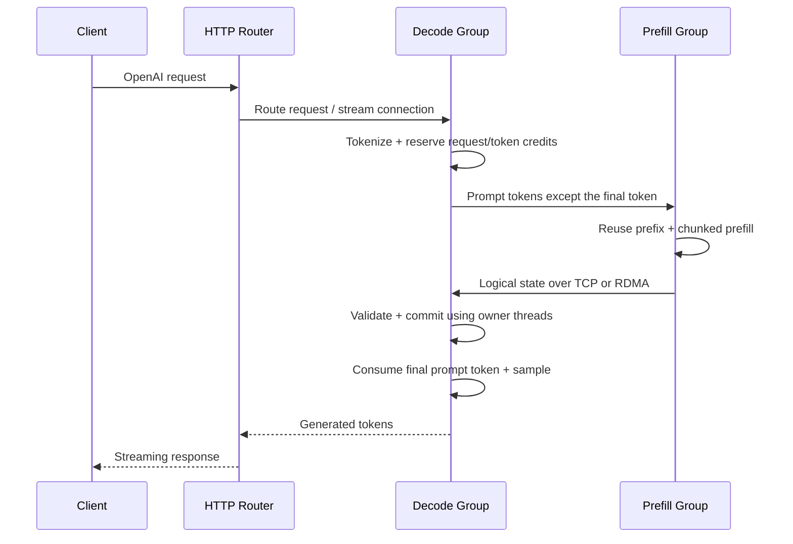

# Fast KV Manager 与 PD 部署

`ftllm router` 管理 P/D 执行组与 HTTP 入口。每个执行组运行一个 `ftllm serve` 进程，可以使用模型已经支持的 TP、attention DP、EP 拓扑；每张 GPU 的模型计算仍由原有持久工作线程负责。网络线程只管理独立 staging buffer，不操作活动请求的页表或 CUDA graph。



D 端保留最后一个 prompt token，导入前 N−1 个 token 的状态后重新计算第一个输出。因此采样器、工具约束、输出流只由 D 端负责，不传输 P 端的随机数状态或已采样 token。

## 构建

在正常 FastLLM CUDA 构建参数中添加 `-DFASTKV_RDMA=ON` 即可启用原生 RDMA。没有该选项时仍支持 TCP。独立组件的构建、接口、依赖和测试见 [fastkv/README.md](../fastkv/README.md)。

两端都需要安装包含本次 PD 支持的 FastLLM。P/D 的权重、模型配置和 KV 表示必须兼容；`model_id` 应使用包含 checkpoint revision 的不可变标识，不能只写一个可变的服务别名。当前协议检查该标识和 adapter 的布局版本，不逐文件计算权重哈希。

## 部署配置

配置文件为 JSON。`command` 是参数数组，不是 shell 字符串；`--pd` 由 router 生成，不要自行放进数组。`endpoint` 是 P 的原生 KV 服务地址，`url` 是 HTTP 就绪检查地址，两者不是同一个端口。以下示例可按模型和显存修改 TP、batch、上下文容量等参数。

```json
{
  "version": 1,
  "name": "deepseek-pd",
  "model_id": "deepseek-v41-flash-1017/checkpoint-revision",
  "state_dir": "/srv/fastllm/pd",
  "transport": {
    "type": "rdma",
    "rdma_devices": ["mlx5_0", "mlx5_1"],
    "max_inflight_bytes": 8589934592
  },
  "prefill": [{
    "name": "p0",
    "ssh": {"host": "operator@prefill-node", "port": 22, "identity": "/home/operator/.ssh/id_ed25519"},
    "python": "/opt/fastllm/bin/python",
    "endpoint": "prefill-node:19000",
    "listen": "0.0.0.0:19000",
    "url": "http://prefill-node:19001",
    "chunk_tokens": 2048,
    "cache_bytes": 1073741824,
    "command": ["/opt/fastllm/bin/ftllm", "serve", "/models/deepseek-v41-flash-1017",
      "--model_name", "deepseek-v41", "--host", "0.0.0.0", "--port", "19001",
      "--tp", "8", "--attn-dp-size", "1", "--ngram_device", "cuda",
      "--moe_device", "multicuda:0,1,2,3,4,5,6,7",
      "--atype", "float32", "--kv_cache_dtype", "fp4_e2m1", "--dspark", "0",
      "--max_batch", "4", "--tokens", "131072", "--max_context_length", "32768"]
  }],
  "decode": [{
    "name": "d0",
    "ssh": {"host": "operator@decode-node", "port": 22, "identity": "/home/operator/.ssh/id_ed25519"},
    "python": "/opt/fastllm/bin/python",
    "url": "http://decode-node:19002",
    "max_inflight": 4,
    "command": ["/opt/fastllm/bin/ftllm", "serve", "/models/deepseek-v41-flash-1017",
      "--model_name", "deepseek-v41", "--host", "0.0.0.0", "--port", "19002",
      "--tp", "8", "--attn-dp-size", "4", "--ngram_device", "cuda",
      "--moe_device", "multicuda:0,1,2,3,4,5,6,7",
      "--atype", "float32", "--kv_cache_dtype", "fp4_e2m1", "--dspark", "0",
      "--max_batch", "4", "--tokens", "131072", "--max_context_length", "32768"]
  }],
  "router": {"host": "0.0.0.0", "port": 8000},
  "ingress": {
    "ssh": {"host": "operator@decode-node", "port": 22, "identity": "/home/operator/.ssh/id_ed25519"},
    "python": "/opt/fastllm/bin/python"
  }
}
```

`env` 可以给每个执行组设置 `CUDA_VISIBLE_DEVICES`、`PYTHONPATH` 等已有运行参数。`state_dir` 可以单独覆盖。没有 `ssh` 的执行组在控制机本地启动；进程管理目前要求 Linux。SSH 私钥留在控制机，不复制到服务节点。`ingress` 用来指定 HTTP router 所在机器；不配置时在控制机运行。

```bash
ftllm router render --config pd.json
ftllm router start --config pd.json
ftllm router status --config pd.json
curl http://decode-node:8000/health
# 完成后停止本次部署拥有的进程组
ftllm router stop --config pd.json
```

`start` 表示进程已创建，模型仍可能在加载。`status` 区分 `running` 和 `ready`。HTTP `/health` 检查 D 以及它的 P 依赖。部署记录包含 PID、启动时间和 boot ID，停止时核实进程身份，不按进程名称批量终止。

可以配置多个 P 和多个 D。D 默认轮转使用所有 P，也可以用执行组的 `prefill` 字段指定 endpoint 子集。HTTP router 负责 D 的队列与会话亲和性，KV 不经过 HTTP router。当前静态分配要求某个 D 的全部 P 依赖都在线；不支持运行中自动变更拓扑。

## 状态、缓存与容量

- D 在发起远端 prefill 前预留请求槽位和按 KV 页大小向上取整的 token 额度，避免大量已完成 P 的请求挤占 D 显存。未获额度的请求排队，不分配活动模型 KV。
- 传输只含逻辑状态，不含模型权重、GPU 地址、allocator page ID、graph 或 scratch buffer。数据完整接收并验证后才由模型 adapter 提交。
- P 默认保留最多 1 GiB 的主存前缀状态，使用 `cache_bytes` 修改，设为 `0` 可关闭。完整命中直接交付；部分命中恢复状态后继续 prefill。缓存被淘汰时，已有读取 lease 仍有效。
- `max_inflight_bytes` 限制接收 staging；P 缓存额度、D 的 `--tokens` 和 HTTP `max_inflight` 是不同的限制，不应混淆。
- 通过已有 `--verbose` 开启逐请求日志：`[FastKV PD] prefix_hit` 记录 P 的前缀复用；`handoff_ms` 包含排队、P 计算、打包、传输和导入，不是纯网络耗时。D 的 API `cached_tokens` 当前不把远端 P 命中计入本地缓存统计。

## 模型接入与当前边界

DeepSeek V4.1 的 adapter 交接窗口、压缩 KV、indexer、未完成的压缩 tail 和 Engram 历史；共享 KV 的源层只导出一次。Attention DP/TP 的分组可与 P 不同，由 D 的模型执行器恢复到本地拥有者。

Naive N0.5 的 adapter 交接各 TP rank 的逻辑 KV、完整注意力的分页内容和滑窗的时间顺序。远端页号不会直接用作本地页号。当前要求 P/D TP 大小一致；稀疏/offload KV、indexer context sharding 和 draft TP 会明确拒绝。

Naive 部署复用同一份 router 配置结构，将两个执行组的模型路径和 `model_id` 改为对应 checkpoint，P/D 使用一致的 TP 和 KV dtype。例如各执行组可使用以下命令数组对应的参数，端口按角色分别设置：

```bash
ftllm serve /models/Naive-N0.5-Flash-FP8 \
  --model_name naive-n05-flash --host 0.0.0.0 --port 19001 \
  --tp 4 --dtype auto --atype bfloat16 --kv_cache_dtype bfloat16 \
  --max_batch 4 --tokens 131072 --max_context_length 32768 \
  --chunked_prefill_size 2048 --dspark 0
```

当前部署路径支持文本请求。多模态 PD 需要继续补充媒体身份与状态 adapter，目前明确拒绝，不能通过仅传 token 冒充多模态交接。DeepSeek 的 DSpark 5 已覆盖贪婪、随机采样、长前缀续接和并发交接。P 的中间 prefill 不运行推测步，D 恢复 committed KV 边界后重新生成草稿；P/D 的 DSpark 开关需要保持一致。Naive 的 draft TP 暂不支持，使用 `--dspark 0`。

当前模型导入使用主存 staging 后由 GPU 拥有者恢复；传输组件具备 GPUDirect buffer 能力，但这不等于模型适配已实现全程 GPU 零拷贝。小 buffer 已合并到有界 arena 中，减少 RDMA 注册次数。连接复用、分层传输与计算重叠属于后续性能工作。

新增模型需要实现 `PDLayout`、`ExportPDState`、`ImportPDState`，并覆盖全量交接、前缀续接、页边界、并发、取消和错误布局测试。逻辑分片规划独立于通信后端；未来多机 wide-EP 的进程组与 collective 属于计算层，需要单独接入，不能仅靠增加 router 的 D 节点来替代。
