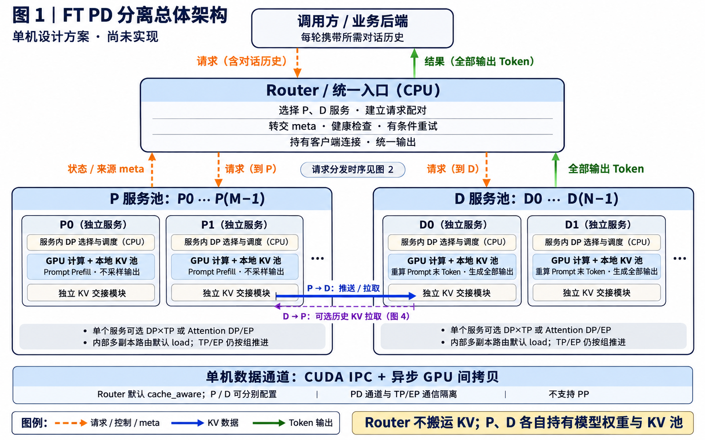
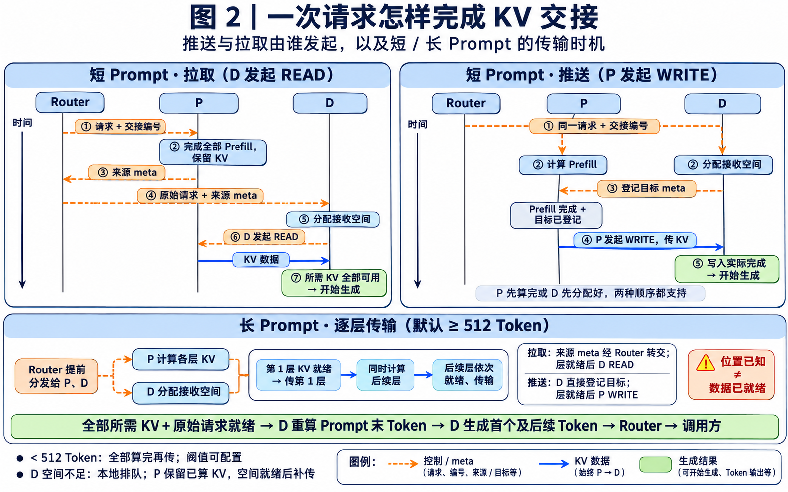
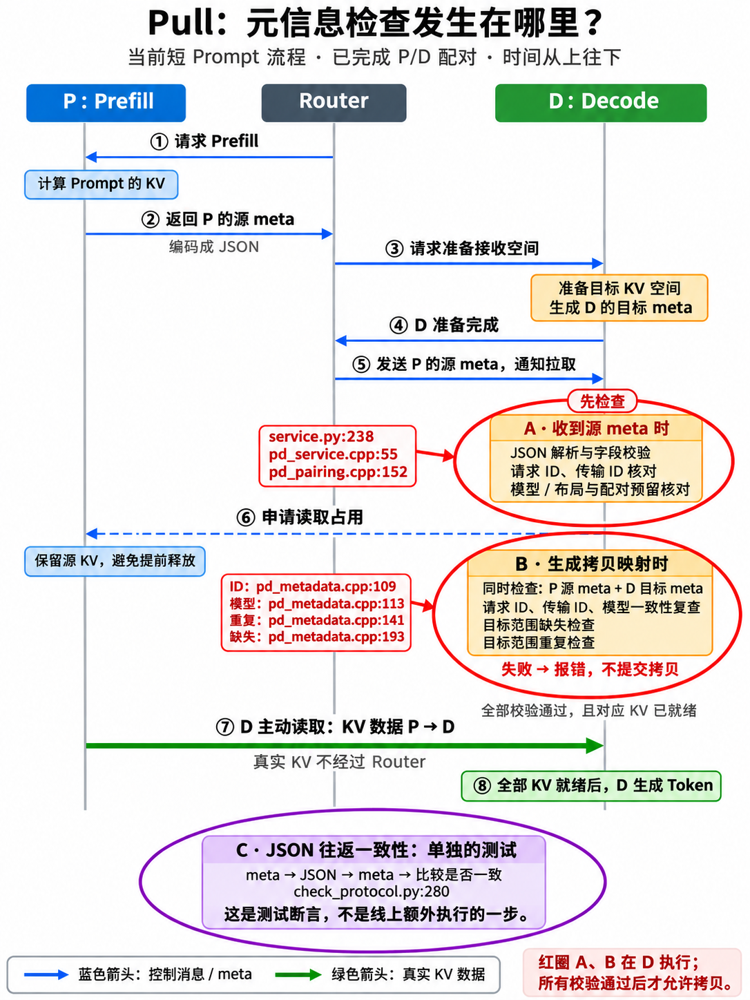
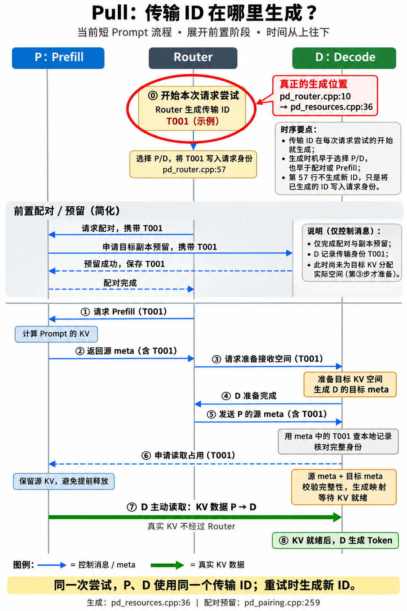
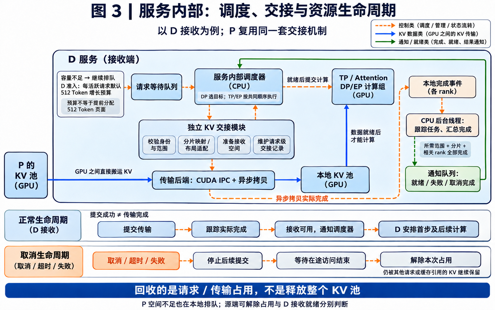
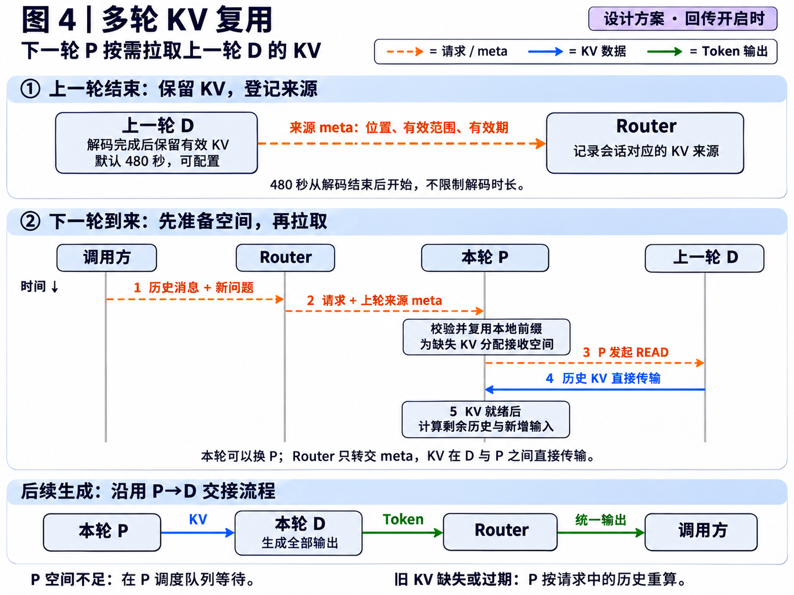

# PD 分离设计与实现清单

本文汇总已确认的 PD 分离设计、功能清单与流程图。图 1～4 表示设计方案，
图 5、6 说明当前短 Prompt Pull 的代码流程；图示本身不代表通过验收，
各项实现与验收状态以对应条目的记录为准。
待办内容和状态继续在 [项目待办](../../project/TODO.md#pd-分离实现清单) 中维护。
实施顺序与阶段交付条件见[单机 PD 分离实施计划](IMPLEMENTATION_PLAN.md)。
当前代码范围、尚未完成事项及服务器验证入口见[实现状态与运行说明](RUNNING.md)。
各模块的 C++/CUDA 与 Python 适配边界见[核心逻辑原生迁移](NATIVE_MIGRATION.md)。

**讨论边界（2026-11-25 已确认）：** KV 重分片算法、meta/API 字段、内部结果流协议、
逐层传输与 CUDA Graph 的配合不再展开细化讨论，具体细节留到编码阶段依据既定要求落实。
这四项不再列为架构讨论的待定项；相关条目中的“后续补充”指实现阶段细化，
既定功能范围和约束继续保留，尚未实现或验收的状态不因此改变。

## 总体架构

P 负责 Prompt 的 Prefill 与 KV 交接，D 负责首个及后续全部输出 Token 的生成。
Router 选择 P/D 服务、协调交接并统一输出；KV 数据由 P/D 之间的独立通道直接传输。



### 阅读导航

| 内容 | 说明 |
|---|---|
| [并行模式](#并行模式)与 [KV 重分片](#kv-重分片) | P/D 部署组合、分片映射及职责边界。 |
| [Router 与现有调度](#routerproxy-与现有调度复用) | 服务选择、策略、健康检查、重试和容量背压。 |
| [请求交接流程（图 2）](#kv-推送与拉取) | 短 Prompt 推送/拉取，以及长 Prompt 逐层传输。 |
| [Pull 元信息检查（图 5）](#pull-metadata-checks)与 [传输 ID（图 6）](#pull-transfer-id) | 当前短 Prompt Pull 的检查阶段、ID 生成与分发时机。 |
| [服务内部架构（图 3）](#异步传输任务管理) | 调度、交接接口、异步完成通知及资源生命周期。 |
| [多轮 KV 复用（图 4）](#kv-回传与多轮复用) | 下一轮 P 从上一轮 D 拉取历史 KV。 |
| [准确性比对与验收原则](#准确性比对与验收原则) | 比较优先级、FAIL 与 WARNING 的边界。 |

以下章节保留已确认的功能要求与实际实现、验收状态。

## 并行模式

PD 分离拟支持以下并行组合：

| P 端 | D 端 |
|---|---|
| `DP×TP` | `DP×TP` |
| `DP×TP` | `Attention DP/EP` |
| `Attention DP/EP` | `DP×TP` |
| `Attention DP/EP` | `Attention DP/EP` |

DP 指普通副本 DP。DP、TP 可以为 1，P/D 两端规模可以不同。

**不支持 PP。具体实现方案后续补充。**

## Qwen2 MoE 普通进程 DP×TP 支持

- 补齐未量化 Qwen2 MoE 在普通进程 TP 下的执行支持，并接入普通 DP 多副本流程，
  支持该模型使用普通 `DP×TP` 部署。
- 同一模型、同一份权重能够分别通过普通 `DP×TP` 和 `Attention DP/EP` 执行，
  作为两种模式混合部署 P/D 的前置能力；两种模式均可承担 P 或 D 角色。
- 复用已有模型加载、算子、KV 管理和调度能力，补齐正式推理路径；不能仅放开模型类型检查。
- 模型在两种并行模式下的执行支持与 PD 的 KV 交接分别验证，单端能运行不代表 PD 已完成。

记录日期：2026-11-24。状态：需求已确认，待实现。具体模型接入与并行执行方案后续补充。

## KV 重分片

PD 分离拟支持 P/D 两端 KV 分布不同时的重分片，包括不同 TP 规模之间的
切分、合并和必要的复制，将 KV 按 D 端的分片方式放到对应 GPU，保持 KV 内容与逻辑位置不变。

仅改变普通 DP 副本数量时，按请求将 KV 交给目标副本，不要求按头重新切分。

### 分片映射与职责分工

- Router 负责选择 P、D 服务；请求具体落在哪个 DP 副本，由路由或服务内部 DP 调度确定。
  目标副本确定后，由独立 KV 交接模块完成分片映射、布局对齐与传输，Router 不负责搬运或拼接 KV。
- KV 交接模块根据两端的 TP 拓扑与 KV 布局，确定源/目标 rank、各层及 Token 范围、
  KV 头或相应缓存分片的对应关系，以及源/目标块内的读写位置和偏移。
  TP 规模不同时，按映射完成切分、汇集和必要的复制，保持 KV 内容、头序及逻辑位置一致。
- 拓扑与布局不变时，可复用握手阶段生成的 rank/分片映射；每个请求仍须单独绑定自己的
  KV 块号、有效范围和读写位置，不能仅凭拓扑相同沿用上一请求的块号。拓扑或布局变化后重新生成映射。
- 普通 DP 的多个副本是请求调度的候选目标，不因 D 有多个 DP 副本，就把同一请求的 KV
  分散到这些独立副本。重分片发生在选定的 P、D 副本各自的 TP 组之间。

例如，P 为 `DP1×TP2`，D 为普通 `DP4×TP1`，共有 8 个 KV 头并按头切分。
调度选中 D 副本 2 后，KV 交接模块执行 `TP2→TP1` 的汇集：

| P 端来源 | KV 内容 | D 端目标 |
|---|---|---|
| P rank 0 | KV 头 0～3 | D 副本 2 中对应头 0～3 的区域 |
| P rank 1 | KV 头 4～7 | D 副本 2 中对应头 4～7 的区域 |

允许两个 P rank 分别将分片传到目标副本的对应区域，不强制先在 P 端合成完整 KV 再传输。
D 副本 2 所需的 KV 和原始请求就绪后，从首个输出 Token 开始生成；其余三个 D 副本可处理其他请求。
推送与拉取模式复用上述映射与对齐能力。

记录日期：2026-11-24。状态：需求已确认，待实现，尚无分片映射与对齐的验收结果。
具体布局适配、映射接口和传输实现方案后续补充。

## Router/Proxy 与现有调度复用

- Router/Proxy 属于统一入口层，负责多个独立推理服务之间的请求路由，
  与各服务内部的 DP 副本选择分开设计。
- 非 PD 场景选择一个实例完成整个请求；PD 场景分别选择 P、D 实例，
  增加 P/D 配对与 Prefill→Decode 的交接协调。
- Router/Proxy 的服务级策略按下述[Router 策略支持](#router-策略支持)要求推进，
  不沿用 FT 实例内部的轮询、前缀匹配、`load` 三种策略体系；默认采用 `cache_aware`，
  默认策略及相关配置项对齐 vLLM Router。
- 完整推理服务以及 P、D 服务内部的副本选择，按[实例内部请求路由统一](../../project/TODO.md#实例内部请求路由统一)
  要求推进；默认 `load` 和健康副本轮询等约定限定于实例内部，不决定 Router 的服务级策略。
- 单机 PD 交接先根据实际 KV 分片传输边筛选可达副本，再在候选中应用各端内部策略。
  双端将配对绑定到本次交接；预留副本不提前分配 D 的 KV。无可行配对明确拒绝，
  不允许两端独立选中不可达组合后再靠重试碰运气。C++ 实现与验收边界见
  [原生迁移说明](NATIVE_MIGRATION.md)，2026-11-27 新增代码尚待服务器验收。
- P、D 保留各自实例内部的请求排队、Batch 组织和计算调度，复用现有 TP、
  Attention DP/EP 计算及组内同步流程；入口路由不替代实例内部调度。
- 路由与结果输出共用统一入口，KV 数据由独立 KV 交接模块在 P/D 之间直接传输，
  入口只转交请求和交接元数据。

记录日期：2026-11-24。状态：需求已确认，待实现。具体接口与复用方案后续补充。

## Router 服务健康检查

FT 的服务级 Router 健康检查对齐 vLLM Router，对已注册的 P、D 服务分别维护健康状态。
采用以下命令行配置项与默认值，均支持显式配置：

| 配置项 | 默认值 | 含义 |
|---|---|---|
| `--health-check-endpoint` | `/health` | Router 向服务发送 HTTP GET 探测的路径。 |
| `--health-check-interval-secs` | `60` | 周期性健康探测的间隔，单位为秒。 |
| `--health-check-timeout-secs` | `5` | 单次健康探测的超时时间，单位为秒，不是推理请求超时。 |
| `--health-failure-threshold` | `3` | 连续探测失败达到该次数，标记为不健康并停止分配新请求。 |
| `--health-success-threshold` | `2` | 不健康后连续探测成功达到该次数，恢复健康候选资格。 |

- 探测返回 HTTP 2xx 视为成功；非 2xx、连接错误或超时视为失败。
  每次成功清零连续失败计数，每次失败清零连续成功计数；P、D 各服务独立计数。
- 不健康服务仍保留在注册表中，继续按相同周期探测，直到连续成功达到恢复阈值。
  健康恢复后重新参与路由选择；显式注销服务与健康检查暂时停止分流分别处理。
- 所有服务级路由策略均排除不健康服务，会话绑定也不能绕过该检查。
  健康状态用于判断服务可用性，负载和 KV 容量另行判断，忙碌本身不等于不健康。
- 停止分流只限制新请求的目标选择；已在途请求与 KV 传输继续按各自的完成、超时、取消
  和异常收尾规则处理，不因健康标记变化直接回收仍被使用的资源。
- 健康恢复不强制把已改绑的会话迁回原服务；会话闲置超时仍由对应策略单独管理。

参考：[vLLM Router 健康检查默认配置，main.rs:402](https://github.com/vllm-project/router/blob/main/src/main.rs#L402)、
[探测结果与连续计数，worker.rs:432](https://github.com/vllm-project/router/blob/main/src/core/worker.rs#L432)、
[持续探测已注册服务，worker_registry.rs:403](https://github.com/vllm-project/router/blob/main/src/core/worker_registry.rs#L403)。

记录日期：2026-11-25。状态：健康探测、停止分流与恢复规则已确认，待实现，尚无验收结果。
下一步：接入健康端点、周期探测与候选池更新，验证默认值、配置覆盖、连续计数重置、
不健康期间继续探测及恢复后重新参与路由。

## Router 策略支持

PD 分离的服务级 Router 拟支持以下八种策略，借鉴 vLLM Router 的策略能力：

| 策略 | 功能要求 |
|---|---|
| `round_robin` | 在健康候选服务中轮询选择。 |
| `random` | 从健康候选服务中随机选择。 |
| `power_of_two` | 随机选两个健康候选服务，再选择负载较低者。 |
| `cache_aware` | Router 根据历史请求分发记录估计前缀匹配，结合负载选择服务；匹配不足或负载明显失衡时优先低负载服务。 |
| `kv_aware` | 根据服务发布的 KV 缓存新增、删除等事件维护缓存记录，结合可复用前缀与负载选择服务。 |
| `consistent_hash` | 根据会话等稳定标识做一致性哈希，使相同标识尽量映射到同一服务。 |
| `sticky_least_loaded` | 新会话选择活跃会话数最少的健康服务，并维护绑定；后续请求在绑定有效、目标健康时沿用该服务。 |
| `rendezvous_hash` | 对“会话等稳定标识＋服务地址”计算哈希，选择哈希值最大的健康候选服务，保持稳定映射。 |

- P、D 两端的策略可以分别配置，支持使用相同策略或不同策略组合。
- `cache_aware` 的历史匹配是缓存估计，不代表 KV 必然仍驻留；`kv_aware` 使用缓存事件维护状态。
- `sticky_least_loaded` 的活跃会话数与未完成请求数分开统计；`rendezvous_hash` 的哈希值不是负载分数。
- 本条规定服务级策略范围，不修改实例内部 DP 副本选择的既定策略与默认 `load` 要求。
- Router 默认策略与相关配置按下述要求对齐 vLLM Router；其他策略的负载统计、评分及
  会话生命周期等具体实现方案后续补充。

### 默认策略与配置

FT 的 PD Router 采用以下命令行配置项与默认值：

| 配置项 | 默认值 | 含义 |
|---|---|---|
| `--policy` | `cache_aware` | P、D 共用的默认服务级路由策略，可显式选择上述八种策略。 |
| `--prefill-policy` | 未指定，继承 `--policy` | 单独覆盖 P 端策略。 |
| `--decode-policy` | 未指定，继承 `--policy` | 单独覆盖 D 端策略。 |
| `--cache-threshold` | `0.3` | 前缀匹配比例阈值，即 30%。 |
| `--balance-abs-threshold` | `64` | 同一候选池中最大负载与最小负载的差值阈值。 |
| `--balance-rel-threshold` | `1.5` | 同一候选池中最大负载相对于最小负载的倍数阈值。 |

- 配置优先级为：显式指定的 P/D 策略 > 公共 `--policy` > 默认 `cache_aware`。
  所有策略参数均未指定时，P、D 都使用 `cache_aware`；仅覆盖一端时，另一端继续继承公共策略。
- `cache_aware` 的负载按 Router 维护的未完成请求数统计。分别在 P、D 各自的健康候选池内
  取最大、最小负载，不把 P、D 的负载混在一起比较。
- “明显失衡”须同时满足 `max_load - min_load > balance_abs_threshold` 和
  `max_load > min_load * balance_rel_threshold`；默认即差值严格大于 64，且最大负载
  严格大于最小负载的 1.5 倍。
- 上述阈值可通过命令行调整，仅用于启用 `cache_aware` 的阶段；P、D 分别判断各自候选池。
  这些服务级默认值不改变实例内部 `--dp-routing` 默认 `load` 的既定要求。

### cache_aware 三种情况的选择规则

启用 `cache_aware` 时，P、D 在各自的健康候选池内按以下三种情况选择服务：

| 情况 | 判定条件 | 处理 |
|---|---|---|
| 负载比较均衡，前缀匹配比例超过阈值 | 未达到明显失衡条件，且最高前缀匹配比例严格大于 `cache_threshold`。 | 选择前缀匹配最多的服务。 |
| 前缀匹配不足 | 未达到明显失衡条件，且最高前缀匹配比例小于或等于 `cache_threshold`。 | 选择负载最低的服务。 |
| 实例之间负载明显失衡 | 同时超过负载差值阈值和负载比例阈值。 | 不论前缀匹配比例多高，均优先选择负载最低的服务。 |

先判断负载是否明显失衡；未明显失衡时，再按前缀匹配比例区分前两种情况。
“最高前缀匹配比例”指当前请求在该候选池中的最高估计匹配比例；“匹配不足”是所有候选服务
都未超过阈值，不要求完全没有匹配。默认最高匹配比例恰好为 30% 时，也按匹配不足处理。
用户修改阈值后，三种情况均按实际配置值判断。

参考：[vLLM Router 默认策略，main.rs:126](https://github.com/vllm-project/router/blob/main/src/main.rs#L126)、
[阈值默认配置，main.rs:183](https://github.com/vllm-project/router/blob/main/src/main.rs#L183)、
[前缀选择条件，cache_aware.rs:365](https://github.com/vllm-project/router/blob/main/src/policies/cache_aware.rs#L365)、
[失衡条件，cache_aware.rs:445](https://github.com/vllm-project/router/blob/main/src/policies/cache_aware.rs#L445)。

更新日期：2026-11-24。状态：八种策略、默认配置及 `cache_aware` 三种情况的处理要求已确认，
均待实现，尚无功能或性能验收结果。

## Router/Proxy 有条件请求重试

- 对齐 SGLang Router 的请求级重试，由统一入口决定是否重新发起 P/D 请求。
  HTTP 5xx、429 指入口收到的 P 或 D 的接口响应；KV 传输失败须反馈到请求层，
  再按下述条件判断，不将所有 KV 中断都视为可自动重试。
- 最大尝试次数可配置，首次执行计入总次数；默认 1，即不自动重试，设置大于 1 时开启。
- 可重试错误包括连接/传输错误、超时、熔断拒绝、HTTP 5xx 和 429；其他 4xx 及成功响应
  不自动重试。请求取消或客户端断连后，不再发起自动重试。
- 重试只允许发生在统一入口尚未向客户端发出响应时。流式 2xx 成功响应头一旦发出，
  后续故障不再自动重试，即使尚未发送 Token；避免重复或拼接不同尝试的输出。
- 每次重试须同时满足次数有剩余、未超过请求总截止时间、仍有符合条件的候选实例。
  所有尝试与退避等待共享同一总截止时间，重试不重置总时限；无候选或预算耗尽时返回失败。
  单次请求超时可配置：非流式覆盖整次响应，流式覆盖等待响应头的阶段。
- PD 重试排除失败的一端，重新选择符合条件的 P/D 配对；调用方指定请求 ID 时，
  排除原配对两端，避免仍在处理同一 ID 的实例拒绝重复请求。新配对使用新的交接编号，
  区分新旧尝试；旧交接的迟到消息不能更新新尝试的状态。
- 重试采用带随机抖动的指数退避：退避基值默认 50 毫秒，每次翻倍，最大默认 2000 毫秒，
  实际等待在当前基值的一半到基值之间随机选择；初始等待设为 0 时立即重试。
  退避配置可调整，等待及再次提交均不得越过请求总截止时间。
- 该能力重新发起请求与 KV 交接，不承诺从中断的 KV 分块继续传，也不提供跨实例重启的
  KV 断点续传。旧尝试仍在途的读写遵循“等待在途传输结束再回收”，不能因开始新尝试
  就提前复用旧尝试占用的空间。

参考：[SGLang Router 请求重试条件，REFERENCE.md:253](https://github.com/sgl-project/sglang/blob/main/sgl-router/REFERENCE.md#L253)、
[退避规则，REFERENCE.md:268](https://github.com/sgl-project/sglang/blob/main/sgl-router/REFERENCE.md#L268)。

记录日期：2026-11-24。状态：需求已确认，待实现。具体配置名、错误上报与状态接口后续补充。

## P/D 路由与背压

- 选择 P：考虑待处理的 Prompt Token 数、排队情况和前缀缓存命中情况。
- 选择 D：考虑运行负载、可用 KV 空间和已承诺接收的请求。
- 考虑 P→D 的 KV 传输积压；待交接 KV 计入 P 的本地占用，P 通过下述容量检查与
  调度排队限制后续请求开算。Router 额外的入口限流和积压控制规则另行讨论。
- 单个请求的通知与 D 空间分配时机按下述 [KV 推送与拉取](#kv-推送与拉取)要求对齐
  vLLM NIXL；不统一设置“D 预留成功，P 才能开始 Prefill”的前置条件。
  D 的实际分配由 D 内部调度与 KV 池管理器完成；Router 的容量信息用于选路和准入，
  不能替代 D 的实际分配结果。
- **容量不足时，已路由到 D 的新请求统一在 D 内部的调度等待队列排队，等待分配 KV
  接收空间；推送与拉取共用此规则。** Router 的入口限流与排队另行管理。
  排队限额与超时配置后续补充；P 端容量背压按下述原则执行。

### P 端 KV 容量背压与排队

- **对齐已讨论的 vLLM 原则：积压 KV 占用 P 的空间，新请求申请不到 KV 块时，
  在 P 内部的调度等待队列继续排队。** P 已算完但尚待 D 分配空间、读取或接收的 KV，
  以及在途传输仍需访问的源 KV，都按实际生命周期计入本地占用。
- 复用 P 调度器与 KV 池的容量检查，先按下述通用规则淘汰可回收缓存；
  新请求当前计算所需的 KV 块仍分配失败时，
  不准入该次计算，等待后续调度重新检查。空间可用后，按既有调度策略重新尝试分配，
  分配成功再开算；不要求 D 预留成功后 P 才能开始 Prefill。
- 解除占用仍遵循交接生命周期及前缀缓存规则；**等待在途传输结束再回收**，
  不能为接纳新请求而覆盖仍被使用的 KV。等待请求继续受既定取消与超时规则约束。
- 推送、拉取及长 Prompt 逐层传输均采用此原则。D 空间不足时在 D 队列等待，
  P 空间不足时在 P 队列等待，各自的调度器负责容量检查与后续推进。
- 本项以 P 本地 KV 容量形成背压。Router 按总积压另设暂停、恢复阈值属于额外准入策略，
  后续另行讨论，不作为本项运行的前置条件。

记录日期：2026-11-25。状态：P 端容量背压、排队与恢复推进原则已确认，待实现，尚无验收结果。
下一步：接入待交接 KV 占用统计及 P 调度队列，验证容量不足时等待、空间可用后推进，
以及取消、超时和在途传输期间的占用保护。

### D 端容量准入与 Decode 增长预算

- D 的新请求准入保留此前确认的 SGLang 式增长预算：接收新请求前，先为已接纳请求的后续
  Decode 留出增长预算，再判断能否分配新请求的完整接收空间及其自身增长额度。
  推送与拉取共用该准入规则；请求分发和 D 分配的时间顺序仍按 vLLM NIXL 要求执行。
- 支持 `--num-reserved-decode-tokens`，默认每个活跃请求保留 **512 Token** 的增长预算，
  支持显式配置。活跃请求统计覆盖运行中、已接收待执行以及已占用 D 接收空间的在途请求，
  同一请求不能重复计数；新接纳请求也须计入后续预算。
- 增长预算是准入时从可分配容量中扣除的额度，不要求提前给每个请求实际分配 512 Token
  的 KV 页面。接收 Prompt KV 所需的页面仍须实际分配；预算按模型、精度、并行分片及
  页面布局换算，同时核算已有 KV 占用、可安全回收的缓存和等待恢复请求的空间需求。
- D 统一执行容量检查及分配状态更新。预算不足时，新请求统一留在 D 的调度等待队列，
  不登记不可用的接收位置，也不提交对应 KV 读写；P 侧按上述本地 KV 容量规则限制后续开算。
  可分配容量变化后，由 D 调度器重新检查增长预算与接收空间需求，分配成功后才推进传输。
  已算完的 P 按交接生命周期保留源 KV，等待仍受取消和超时规则约束。
- 512 Token 是准入增长预算，不是输出上限或完整生成期间的容量保证，也不标为 vLLM V1
  的默认值。缓存淘汰、运行中空间不足及恢复统一采用下节的 vLLM V1 对齐规则：
  先回收可淘汰缓存，仍不足时抢占部分运行请求，保留请求状态并重新排队，恢复时重算缺失 KV。
  D 的恢复重算在 D 本地执行，不要求先备份到 CPU；实际在途读写结束后才能解除相关占用。

参考：[SGLang 默认增长预算，disagg.py:115](https://github.com/sgl-project/sglang/blob/main/python/sglang/srt/arg_groups/fields/disagg.py#L115)、
[容量扣除，decode.py:2823](https://github.com/sgl-project/sglang/blob/main/python/sglang/srt/disaggregation/decode.py#L2823)。

更新日期：2026-11-25。状态：512 Token 准入预算保留，运行时回收与恢复改为对齐 vLLM V1，
待实现，尚无验收结果。下一步：补充预算与页面换算、队列衔接和本地重算接入，
验证并发准入、排队推进、增长保护及异常清理。

## 通用 KV 淘汰、抢占与重算恢复

- **回收与恢复行为对齐 vLLM V1，作为 PD 与非 PD 共用的 KV 容量管理能力。**
  复用 FT 的缓存、调度与计算流程；本项规定行为，缓存索引和存储布局按既定统一事项推进。
- 需要空间时，优先使用空闲空间，并按 LRU 淘汰没有有效占用的可复用缓存。
  仅因长时间未被新请求命中，不足以判定可以淘汰；被运行请求、在途计算或传输引用，
  以及仍受回传保留约定保护的 KV，不能按普通冷缓存直接回收。
  P、D 启用可复用缓存时共用该原则，不限定于 P。
- 淘汰后仍不足时区分两种情况：新请求继续在所属实例的调度等待队列排队；
  运行请求下一步所需 KV 无法分配时，由所属实例调度器选择可安全抢占的请求，
  暂停其执行并释放该请求的 KV 占用，重新放入本地等待队列。
  其他请求仍引用的共享 KV 不能随之强制释放。
- 抢占不要求将整份 KV 备份到 CPU。保留原始 Prompt、已生成 Token、生成计数、采样及
  停止状态；恢复时重新匹配有效前缀，按原始 Prompt 与已生成 Token 重算缺失 KV，再继续生成。
  统一入口保留已发送进度；重建历史 KV 时不重新采样或重复发送已有输出 Token。
- PD 的 D 被抢占后，在 D 本地执行恢复重算，属于同一请求的内部恢复，不要求返回 P
  再做一次交接，也不作为 Router 请求级重试。D 继续负责全部输出 Token 的生成。
- PD 接收、待交接、在途传输及 D→P 回传保留状态接入同一占用检查；被抢占请求的资源
  仍须等待此前计算与在途传输结束后才可复用。请求停止计算不等于传输已结束，
  不能靠抢占绕过“等待在途传输结束再回收”的要求。

参考：[vLLM V1 缓存淘汰说明](https://docs.vllm.ai/en/stable/design/prefix_caching/#eviction-lru)、
[运行请求容量不足时选择抢占对象，scheduler.py:910](https://github.com/vllm-project/vllm/blob/main/vllm/v1/core/sched/scheduler.py#L910)、
[释放占用、重置计算进度并重新排队，scheduler.py:1867](https://github.com/vllm-project/vllm/blob/main/vllm/v1/core/sched/scheduler.py#L1867)。

记录日期：2026-11-25。状态：LRU 淘汰、抢占与本地重算恢复要求已确认，待实现，尚无验收结果。
下一步：补充可回收引用判定、抢占选择与队列顺序、重算入口和状态保持方案，验证缓存淘汰、
新请求等待、运行请求抢占、恢复后输出连续，以及共享 KV 和在途传输保护。

## P→D 请求状态交接

- **P 只负责 Prompt 的 Prefill 和 KV 交接；D 负责首个及后续全部输出 Token 的生成。**
  FT 的 P 执行路径不采样输出 Token，以 KV 就绪作为交接边界。
- Router 将原始请求及交接关联信息交给 D，包括 Prompt Token ID 和采样、停止等生成规则。
  D 从已生成 Token 数为 0 的状态开始，按原始请求初始化随机数、惩罚历史及停止条件，
  不接收 P 的首 Token、生成计数或采样运行状态。
- P→D 交接内容为请求与交接身份、模型与布局标识，以及各层 KV 的有效长度、位置和分片描述。
  原始请求与 KV 按交接编号关联，KV 数据仍由 P、D 直接传输。
- 所需 Prompt KV 全部可用、请求已准备好后，由 D 调度器安排首步计算：复用前缀 KV，
  重算 Prompt 最后一个 Token，得到 logits 并采样首个输出 Token，再继续后续 Decode。
  例如 Prompt 长度为 L，D 的首步输入是位置 L−1 的 Prompt Token，首个输出位于位置 L。
  meta 如实描述已交接的 KV 范围；末 Token 重算按正确位置更新 KV，不重复追加 Prompt。
- D 的生成计数、采样状态及停止判断由 D 本地维护；D 被抢占后保留已有请求的状态，
  在本地重算缺失 KV 后继续生成，按上述通用恢复规则执行。
  多轮 D→P 回传只复用旧 KV，新一轮按新请求初始化生成状态。

更新日期：2026-11-25。状态：P/D 职责与首 Token 边界已确认，替代此前 P 生成首 Token 的方案；
2026-11-26 已接入首版角色与首步计算代码，尚无编译和 GPU 验收结果，详见 [运行说明](RUNNING.md)。

## KV 交接 meta 数据结构

- 首版 meta 使用 JSON，承载交接描述，不包含 KV 数据本体。
- 固定信息在握手时协商，包括模型标识、TP 拓扑、KV 精度、分页或连续布局，以及层和
  KV 头的分布；协商后通过 `layout_id` 引用。每次交接只传本次请求及 KV 位置等变化信息。
  `layout_id` 描述对应实例的布局，P/D 可以不同；实例重启或拓扑、布局变化后重新协商。

每次交接采用以下字段结构：

| 字段 | 含义 |
|---|---|
| `version` | 协议版本，首版为 `1`。 |
| `kind` | 区分 KV 来源描述与接收位置登记。 |
| `request_id` | 所属请求的标识。 |
| `transfer_id` | 本次交接的唯一编号；重试使用新编号。 |
| `owner` | 所描述 KV 所在的实例及 DP 副本；实例标识须区分不同启动。 |
| `layout_id` | 引用该实例已协商的布局，由交接模块解释并完成两端映射。 |
| `token_start`、`token_count` | 有效 Token 的逻辑起点和数量，区别于存储地址与字节偏移。 |
| `segments` | 按 rank 描述 KV 块或连续存储区间，并关联对应层及分片范围。 |
| `retention` | 来源 KV 的保留标识和有效期，用于判断是否仍可读取，支持回传的 480 秒管理。 |

- KV 位置使用“已登记的内存区域＋块号或偏移”表示，由传输后端转换成可访问地址；
  分页与连续 KV 使用对应的位置描述，字段细节及范围校验后续补充。
- P→D 拉取：P 导出自己的来源描述，由 Router 随请求转交 D。
  P→D 推送：D 分配接收空间后，直接向 P 登记目标位置。
  D→P 回传：D 提供来源描述，Router 在下一轮将其交给 P 使用。
- `retention` 表达来源 KV 的保留约束；D 为多轮复用保留 KV 的 480 秒从本轮解码完成后
  开始计时，继续遵循[KV 回传与多轮复用](#kv-回传与多轮复用)的有效期及在途传输回收规则。
- 标准 P→D 交接不携带首 Token、生成计数或采样运行状态，也不要求单独传输续跑 JSON。
  原始请求中的 Prompt 与生成规则由 Router 提供，D 据此初始化；不在 KV meta 中重复填写。
  D→P 多轮回传同样只描述可复用 KV，不迁移旧轮的生成进度或随机数运行状态。

记录日期：2026-11-25。状态：JSON、握手复用及字段结构已确认，待实现，尚无验收结果。
具体字段类型、必填/可选规则、枚举值、子结构细节及序列化与校验接口后续补充。

## 独立 KV 交接模块与统一 API

- 将 KV 交接实现为独立模块，对外提供统一 API，内部按职责拆分文件；P、D 的计算流程
  通过这些接口完成交接，复用现有并行计算流程。
- 导出：提供 KV 引用、布局描述和数据就绪依赖，保护仍被传输读取的数据。
- 接收与导入：校验请求与布局，准备目标空间，接收 KV，按需重分片并报告 KV 可用。
  D 的生成状态初始化和首步计算由 D 的请求调度与计算流程负责。
- 完成与取消：通知数据就绪，处理失败、取消及占用解除，遵循交接状态机与 KV 生命周期规则。
- TP、Attention DP/EP 的布局差异由模块内的适配层处理，底层传输方式可替换。
- 源/目标 rank、KV 分片及读写偏移的映射与对齐由本模块负责，职责及示例见
  [分片映射与职责分工](#分片映射与职责分工)。
- 导出不要求额外复制一份 KV，可直接引用 KV 池中的数据；P→D 交接与后续 D→P 回传
  复用同一套机制。

状态：待实现。下面给出接口草案供审阅，具体类型、文件拆分与传输后端接入细节后续补充。

### 交接接口与接入点草案

记录日期：2026-11-25。以下名称和参数为设计草案，并非已存在的代码接口；待审阅后再细化。

- 四个接口供 P、D 服务内部调用。Router 通过服务接口分发请求、转交 meta，不直接访问
  KV 池或调用这些本地接口。
- `context` 表示本次交接上下文：请求与交接编号、推送/拉取模式、传输方向、本端身份及
  已知对端身份。来源 meta、目标 meta 沿用前述 JSON 结构；本地 KV 引用和任务句柄不发给 Router。
- `kv_view` 表示本地 KV 池中的范围、布局及数据就绪依赖；尚未就绪的范围只能先提供位置描述，
  不能读取。标准 KV 导出不带 `resume_state` 参数，生成状态由 D 从原始请求初始化。
  下面仅约定输入、返回及调用阶段，不确定具体语言类型。

| 建议接口 | 输入 | 返回 | 调用阶段 |
|---|---|---|---|
| `export_kv(context, kv_view)`：导出 | 本次交接上下文、本地 KV 引用及就绪依赖 | 来源 meta、本地持有句柄，或错误 | 短 Prompt 在 P 完成 Prefill 后调用；长 Prompt 在来源内存准备后先提供位置描述，按层发布就绪，Prefill 完成后确认完整 KV 范围；回传场景中，D 解码结束后为可复用 KV 建立保留记录。 |
| `prepare_receive(context, request, source_meta)`：准备接收与导入 | 原始请求、交接上下文；推送或长 Prompt 提前准备时可暂缺来源 meta，实际提交 READ 前必须具备 | 等待空间、已准备及本地任务句柄，或错误；推送成功准备时还产生目标 meta | D 收到交接请求后，由调度器执行容量准入；长 Prompt 可先根据请求和已协商布局分配空间；下一轮 P 拉取旧 KV 时复用此接口。 |
| `poll_transfer(context)`：查询完成 | 当前交接上下文 | 等待、传输中、接收可用、失败或取消收尾状态，并提供源端传输占用是否可解除的信息 | 由交接模块的独立 CPU 后台线程跟踪后端事件、汇总相关 rank 状态，通过通知队列交给调度器。 |
| `cancel_transfer(context, reason)`：取消 | 当前交接上下文、取消原因 | 已接受取消且正在收尾，或已完成收尾 | 请求取消、超时或失败时调用；也适用于仍在等待空间、尚无传输句柄的请求。 |

**导出与接收的具体约定：**

- 导出只建立描述与数据保护，不要求复制 KV。交接模块遵守生产 KV 的 GPU 就绪依赖，
  不允许传输读取尚未算好的范围。返回 meta 不等于传输完成。
- 拉取接收：先核对请求、交接身份与已协商布局，再完成容量准入及目标分配。长 Prompt
  可在来源 meta 到达前准备空间；实际提交 READ 前，还须校验来源有效性、布局范围，
  确认待读层或范围已就绪，再由模块计算分片映射并提交读取。空间不足则由调度器继续排队。
- 推送接收：无需等待 P 算出 KV，即可根据原始请求和已协商布局完成容量准入及目标分配；
  成功后由模块直接向 P 登记目标 meta。空间不足则排队，不登记尚未分配的位置。
- 推送发送：P 的导出记录与 D 的目标登记按交接编号关联；目标已登记且待传范围实际就绪后，
  模块内部提交 WRITE。短 Prompt 等全部 Prefill 完成，长 Prompt 按层就绪提交；支持目标
  登记先到或源 KV 先算好，计算流程不另行拼装地址或调用传输后端。
- 推送准备成功只表示可以接收；拉取提交成功只表示读取已开始，二者都不能让 D 提前 Decode。

**完成与取消的具体约定：**

- 接收可用：该次交接要求的 KV 范围、分片和相关 rank 均完成实际传输，所需布局整理与
  同步完成。P→D 场景还须由 D 调度器确认原始请求和生成状态初始化已就绪，才能安排
  首步计算并生成首 Token。组内就绪汇总遵循现有 TP/EP 同步顺序。
- 源端可解除传输占用：后端确认不再读取源范围；如使用独立发送缓冲区，则分别跟踪源 KV
  的复制完成和发送缓冲区的传输完成。解除本次传输占用不等于删除仍被缓存或其他请求使用的 KV。
- 取消先停止后续提交，再等待已经在途的读写结束、对端不再访问本次授权的空间，最后解除
  相应占用。取消受理成功不等于资源已经可复用；源端和目标端都须遵守此规则。
- 同一交接的重复调用与通知不重复提交、执行或解除占用；请求级重试使用新的交接编号。
  失败应返回可定位的原因，调度器沿用既定重试、报错与收尾规则。

**基础调用顺序：**

| 路径 | 接入顺序 |
|---|---|
| P→D 拉取（短 Prompt） | P Prefill 完成 → P 导出 → 服务返回来源 meta，由 Router 连同原始请求转交 D → D 调度准入并准备接收、提交 READ → 接收可用且请求准备好 → D 重算 Prompt 末 Token，生成首 Token 及后续 Token。 |
| P→D 推送（短 Prompt） | Router 分发给 P、D → P 计算并导出，同时 D 调度准入并准备接收、登记目标 → P 完成全部 Prefill 且目标已登记后，模块提交 WRITE → 接收可用且请求准备好 → D 重算 Prompt 末 Token，生成首 Token 及后续 Token。 |
| D→P 回传 | D 解码结束后导出并按默认 480 秒保留 → 下一轮 Router 将旧来源 meta 交给 P → P 调度准入并准备接收、提交 READ → 接收可用 → P 计算剩余 Prompt。 |

- 回传时，下一轮使用新的请求与交接编号，通过旧来源的保留标识及有效前缀建立关联，
  不要求新请求编号等于旧来源请求编号；旧轮采样进度不作为新轮的生成状态恢复。
- 上表的 P→D 路径适用于短 Prompt；长 Prompt 采用下文已确认的
  [逐层交接流程](#长-prompt-逐层交接流程)。逐层就绪发布、增量提交及完整范围确认的
  具体接口细节后续落实，不以“整段 Prefill 完成”作为逐层传输的前置条件。
- 2026-11-26 已新增交接接口、正式进程接入、异步任务管理和单机 CUDA IPC 后端源代码；
  尚无编译或 GPU 验收结果，实际范围与验证入口见 [运行说明](RUNNING.md)。

## KV 推送与拉取



- P→D 交接支持可配置的推送（push）和拉取（pull）两种模式；短 Prompt 的请求分发、
  D 接收空间分配与交接时序对齐本次讨论的 vLLM NIXL 拉取、推送流程。
- 短 Prompt 拉取：Router 先将请求交给 P；P 完成全部 Prefill 后保留源 KV，返回 KV 来源信息。
  Router 再把请求及 KV 来源信息交给 D；D 分配接收空间后，主动发起读取（READ）。
  P 开始计算不等待 D 预留空间，但读取必须等 D 的目标空间实际分配成功。
- 短 Prompt 推送：Router 将同一请求及关联交接信息分别交给 P、D；P 执行 Prefill，D 同时准备
  接收空间并向 P 登记请求标识、接收位置等信息。P 开算不以 D 分配成功为前置条件。
  P 完成 Prefill 且 D 接收位置已登记后，才主动发起写入（WRITE）：D 先准备好就等 P，
  P 先算完则保留 KV 等 D；两者的先后顺序都必须支持。
- D 根据请求的 Prompt Token 数和本地模型、KV 精度、并行分片、存储布局及已有缓存
  确定所需容量，再从本地 KV 池实际分配接收空间；无需等待 P 算出 KV 的具体数值。
  D 自身已知加载的模型及布局，交接前仍需确认两端兼容。
- D 容量不足时，请求统一在 D 的调度等待队列等待分配；P 按交接生命周期保留已算好的源 KV，
  未成功分配或登记的目标空间不能用于传输。等待仍受取消、超时及背压规则约束。
  容量判断采用 [D 端容量准入与 Decode 增长预算](#d-端容量准入与-decode-增长预算)，
  为已有请求保留增长额度后，才允许新请求占用接收空间。
- 两种模式的 KV 数据均从 P 直接传到 D，统一入口只转交请求和元数据。
  D 向 P 登记接收位置属于推送的准备步骤，不等同于 D 发起 KV 读取。
- 两种模式复用统一 KV 交接模块、请求状态交接、重分片与生命周期管理；
  D 在所需 KV 和原始请求就绪后，重算 Prompt 末 Token，从首个输出 Token 开始生成。
- 长 Prompt 采用下节的逐层交接流程：提前分发给 P、D，并按层就绪发起传输。
  “全部 Prefill 完成后才向 D 交接来源信息或开始传输”的时间约束仅适用于上述短 Prompt 路径。

参考：[vLLM NIXL 推送设计](https://docs.vllm.ai/en/latest/design/nixl_kv_push_connector/)、
[vLLM NIXL 拉取与推送时序说明](https://vllm.ai/blog/2026-10-14-nixl-push-connector)。

更新日期：2026-11-25。状态：短 Prompt 基础时序及长 Prompt 逐层交接流程已确认，待实现，尚无验收结果。
具体配置、接口与传输后端接入细节后续补充。

<a id="pull-metadata-checks"></a>

### Pull 元信息检查发生在哪里（图 5）

以下两张图按 **2026-11-28 当前代码的短 Prompt、P→D Pull 流程**绘制。
Router 依次请求 P Prefill、D 准备接收空间、D 拉取，见
[pd_router.cpp:76](../../src/distributed/pd_router.cpp#L76)。长 Prompt 的准备调用采用并发时序，
见 [pd_router.cpp:87](../../src/distributed/pd_router.cpp#L87)，不能直接套用图中的串行步骤。
后文的 [Pull 接收流程统一](#pull-unified-receive) 仍是待讨论方案。



图 5 从已完成 P/D 配对开始。P 的源 meta 描述“从哪里读”，D 在第 3 步准备目标空间，
生成自己的目标 meta，描述“写到哪里”。检查位置如下：

| 图中位置 | 检查内容 | 当前代码 |
|---|---|---|
| A：第 5 步收到源 meta 后、第 6 步申请读取占用前 | 解析元信息；用传输 ID 查 D 本地记录，再核对完整请求身份；核对源描述与配对预留的模型、布局、GPU 和 Head 范围。 | [service.py:238](../../tools/fastllm_pytools/pd/service.py#L238)、[pd_service.cpp:55](../../src/distributed/pd_service.cpp#L55)、[pd_pairing.cpp:152](../../src/distributed/pd_pairing.cpp#L152) |
| B：第 6 步成功后、第 7 步实际拷贝前 | 同时使用 P 源 meta 和 D 目标 meta，复查身份、模型/KV 语义、前缀和 Token 范围；检查源覆盖、目标范围重复及缺失，生成拷贝映射。 | 调用入口 [pd_service_transfer.cpp:250](../../src/distributed/pd_service_transfer.cpp#L250)；身份/布局 [pd_metadata.cpp:109](../../src/distributed/pd_metadata.cpp#L109)；目标重复 [pd_metadata.cpp:141](../../src/distributed/pd_metadata.cpp#L141)；源覆盖 [pd_metadata.cpp:166](../../src/distributed/pd_metadata.cpp#L166)；目标完整性 [pd_metadata.cpp:193](../../src/distributed/pd_metadata.cpp#L193) |
| C：独立测试，不是线上额外步骤 | 将 meta 转成 JSON，再解析回来，断言前后对象一致。 | [check_protocol.py:280](../../test/distributed/pd/check_protocol.py#L280) |

“目标范围重复”检查的是 **D 的目标区域描述**：同一 rank、同一层、同一 K/V 分量内，
Token 和 Head 范围不能同时重叠，并非检查 P 源 meta 是否重复。
第 6 步申请读取占用用于保护 P 源 KV；检查失败会报错，不提交拷贝，已取得的占用进入释放处理，
见 [pd_service_transfer.cpp:231](../../src/distributed/pd_service_transfer.cpp#L231) 和
[pd_service_transfer.cpp:234](../../src/distributed/pd_service_transfer.cpp#L234)。

<a id="pull-transfer-id"></a>

### Pull 传输 ID 在哪里生成（图 6）



**红圈第 0 步生成传输 ID，早于选择 P/D、配对和 Prefill。** 图中的 `T001` 是示例，
实际生成 UUID；同一次尝试的 P、D 使用同一个传输 ID，重试时生成新 ID。

| 阶段 | 行为 | 当前代码 |
|---|---|---|
| 第 0 步：开始本次请求尝试 | Router 调用重试预算的开始方法，通过预算检查后生成 UUID。 | [pd_router.cpp:10](../../src/distributed/pd_router.cpp#L10)、[pd_resources.cpp:29](../../src/distributed/pd_resources.cpp#L29)、[pd_resources.cpp:36](../../src/distributed/pd_resources.cpp#L36) |
| 选择服务后 | 把已有传输 ID 与请求 ID、P/D 身份写入本次交接身份，再放入发给双方的请求体；此处不再生成 ID。 | [pd_router.cpp:57](../../src/distributed/pd_router.cpp#L57)、[pd_router.cpp:60](../../src/distributed/pd_router.cpp#L60) |
| 前置配对与预留 | Router 向 P 发起配对；P 携带同一身份向 D 申请目标副本预留。此时只预留副本，D 的目标 KV 空间在图中第 3 步准备。 | [pd_router.cpp:72](../../src/distributed/pd_router.cpp#L72)、[pd_pairing.cpp:259](../../src/distributed/pd_pairing.cpp#L259) |
| 第 5 步收到 P 源 meta | D 使用 meta 中的传输 ID 查询之前建立的记录，并核对完整身份；因此不需要等第 6 步向 P 申请读取占用后才知道 ID。 | [pd_service_transfer.cpp:222](../../src/distributed/pd_service_transfer.cpp#L222)、[pd_service.cpp:55](../../src/distributed/pd_service.cpp#L55) |

两图中的蓝色箭头表示控制消息或元信息，绿色箭头表示 KV 数据；实际 KV 从 P 直接传到 D，
不经过 Router。图中代码行号对应上述日期的版本，后续代码调整时需同步更新图示与文字定位。

<a id="pull-unified-receive"></a>

### Pull 接收流程统一（后续讨论）

2026-11-28 用户要求记录新的 pull 改造方向，后续讨论；本节为待讨论方案，尚未实施，
不替代上文及下节已有流程的实现与验收记录。待办状态见 [PD-33](../../project/TODO.md#pd-33)。

拟让长短 Prompt 共用同一套接收和拉取流程，将长 Prompt 中分开发送的请求与来源 meta
合并为一次初始化交接：

```text
P 提供源 meta
    ↓
Router 一次向 D 转交：原始请求 + P 的源 meta
    ↓
D 校验交接描述、准备目标空间、申请源 KV 的读取占用
    ↓
D 拉取已就绪的 KV
    ↓
所需 KV 全部接收完成、生成所需状态就绪，D 开始生成
```

| 场景 | 就绪时机与拉取方式 |
| --- | --- |
| 短 Prompt | P 完成 Prefill 后提供源 meta，各层 KV 已就绪，D 可以批量提交读取。 |
| 长 Prompt | P 的源位置准备好即可提供 meta，无需等全部 Prefill 完成；随后逐层报告 KV 就绪，D 按就绪层拉取，与 P 后续层计算重叠。 |

- **meta 已有不代表 KV 已算完。** D 只能在对应数据就绪、目标空间分配成功且源端读取占用
  已获准后提交读取；KV 数据仍在 P、D 间直接传输。
- “一次转交”指原始请求与来源 meta 的初始化交接；后续层就绪、最终完成、失败及取消
  等通知仍按交接编号关联，不能用初始化消息代替实际完成判断。
- 延续已有容量等待、身份与布局校验、在途保护及“等待在途传输结束再回收”原则。
  P 只提供 KV；D 重算 Prompt 末 Token，从首个输出 Token 开始生成。

## 按 Prompt 长度选择 KV 传输时机

- 短 Prompt：P 完成全部 Prefill 后再传输 KV；传输本身可以分块、批量提交。
- 长 Prompt：采用逐层传输，各层待传 KV 就绪后开始传输，与后续层的 Prefill 计算重叠，
  不等待整个请求的 Prefill 完成后才开始传输。
- 长短 Prompt 按单次请求的 Prompt Token 总数判定，初始默认阈值为 **512 Token**，
  支持配置调整：小于阈值采用算完再传，大于或等于阈值采用逐层传输。后续结合模型、GPU、
  传输条件及批次配置实测校准。
- 阈值参考 Splitwise 的 H100 实验结果：论文 §IV-C 说明逐层同步可能干扰计算，尤其对短
  Prompt 增加首 Token 延迟；§VI-A 明确小于 512 Token 时采用串行 KV 传输，较长 Prompt
  采用逐层传输。见 [Splitwise §IV-C，第 7 页](https://arxiv.org/pdf/2311.18677#page=7)
  及 [§VI-A，第 9 页](https://arxiv.org/pdf/2311.18677#page=9)。
- 512 的依据为上述实验参考值，FT 单机传输下的实际收益仍需验证；不将其标为 vLLM
  官方的逐层传输默认阈值，也不与 Chunked Prefill 的批次 Token 预算混用。
- 推送与拉取均支持上述按长度选择传输时机，长 Prompt 使用以下流程。

### 长 Prompt 逐层交接流程

| 阶段 | 拉取 | 推送 |
|---|---|---|
| 提前准备 | Router 提前把请求及关联交接信息交给 P、D；P 开始 Prefill，D 按容量准入规则分配接收空间。 | 同左。 |
| 交换位置 | P 的来源位置准备好后，经 Router 将来源 meta 交给 D，无需等待全部 Prefill 完成。 | D 分配接收空间后，直接向 P 登记目标 meta。 |
| 某层 KV 算好 | P 通知该层就绪；D 在目标空间及来源 meta 可用后，发起该层读取（READ）。 | P 在该层 KV 就绪且 D 已登记对应目标位置后，发起该层写入（WRITE）。 |
| 后续层 | P 继续计算，D 拉取已就绪的层，使传输与后续层计算重叠。 | P 继续计算，同时传输已就绪的层。 |
| 开始生成 | 所需 KV 全部传输完成且原始请求与生成状态初始化就绪后，由 D 调度器安排 Prompt 末 Token 重算，生成首 Token，再继续后续 Decode。 | 同左。 |

- 来源位置描述与数据就绪分开管理：位置准备好不代表该层 KV 已算好，收到 meta 后不能
  提前读取尚未就绪的数据。Prefill 结束时确认本次交接的完整 KV 范围；P 不生成或补发首 Token，
  D 不等待来自 P 的采样运行状态。
- P 开始计算不强制等待 D 分配成功。D 容量不足时仍在调度等待队列排队，不提交读取或
  登记未分配的位置；P 按生命周期规则保留已就绪 KV。D 空间准备好后补传已就绪的层，
  后续层继续按就绪状态传输；等待仍受取消、超时及背压规则约束。
- Router 负责请求分发及拉取所需来源 meta 的转交；KV 数据始终在 P、D 之间直接传输。
  拉取由 D 发起，推送由 P 发起；单层就绪或传输完成均不代表整个请求可以开始 Decode。
- 逐层完成事件、增量提交接口和 CUDA Graph 配合方式后续细化；继续遵守异步任务管理、
  完成判断及“等待在途传输结束再回收”的既定要求。

更新日期：2026-11-25。状态：长 Prompt 拉取与推送的逐层流程、Splitwise 参考来源及初始默认阈值
512 Token 已确认；2026-11-26 已新增逐层发布、增量传输和 Prefill 完整结束判断代码，
尚无 GPU 正确性或实际重叠验收结果。

## 异步传输任务管理



图中调度器与交接模块之间的双向箭头表示接口调用及返回：返回“等待空间、已准备或错误”
不等于传输完成。本地完成事件来自传输后端；实际完成状态经后台线程汇总后，
通过通知队列交给调度器。具体返回约定见[交接接口与接入点草案](#交接接口与接入点草案)。

- P、D 实例的 KV 交接模块采用独立 CPU 后台线程跟踪传输任务，使传输进度检查和收尾
  不依赖调度线程是否正在处理其他请求。
- 各 rank 检查传输后端提供的本地完成状态，在实例内按交接编号汇总。仅在所需 KV 范围、
  分片及相关 rank 全部完成，且必要的布局整理与同步完成后，报告接收就绪。
- 后台线程负责传输状态跟踪、完成汇总、失败处理及取消收尾；通过通知队列传递“就绪、
  失败、取消完成”，通知关联对应的请求与交接编号。
- 调度线程读取通知，统一更新请求状态和可运行队列、安排计算；D 确认原始请求与生成状态
  初始化就绪后，再安排首 Token 的计算。计算提交和 TP/EP 组内同步仍由既有调度流程控制，
  遵守既定通信顺序。
- 取消时先停止后续提交，等待在途传输结束、确认不再访问相关空间，再解除占用并报告
  取消收尾完成。保留源端占用解除与接收端数据就绪分别判断的规则。
- 具体线程数量、检查频率、通知队列实现及唤醒方式结合单机传输后端确定。

记录日期：2026-11-25。状态：独立后台线程、通知队列及职责分工已确认，待实现，尚无验收结果。

## 传输后端实施范围

- 首阶段仅支持单机：P、D 部署在同一台服务器，完成同机实例之间的 KV 传输。
- 单机范围覆盖已确认的 P→D 推送、P→D 拉取和按需开启的 D→P 拉取回传，
  继续遵循既定分片映射、完成判断及在途传输结束后回收的要求。
- 跨机传输后续再讨论，不纳入首阶段实现与验收范围；统一 KV 交接 API 保留传输后端
  可替换的边界，便于后续扩展。
- 单机传输采用 **CUDA IPC＋异步 GPU 间拷贝**：通过 CUDA IPC 交换可共享显存的句柄，
  建立跨进程访问映射，再按交接模块生成的分片与位置映射搬运 KV。
- 拉取时，D 根据 P 的来源句柄及位置描述，发起到本地 KV 池的拷贝；推送时，P 根据 D
  登记的目标句柄及位置描述，发起到 D 的拷贝。D→P 回传复用同一机制，由下一轮 P 发起拉取。
- PD 使用独立传输连接与控制通道，保持与 P、D 内部 TP/EP 通信隔离；复用已有 CUDA IPC
  相关机制时，仍须按 PD 的身份、范围校验及生命周期规则接入。
- 建立访问关系前检查显存是否可共享、对应 GPU 间的 P2P 能力及访问条件；不满足时明确
  返回不支持，由既定失败流程处理。CPU 中转兜底列入后续功能，首阶段不依赖该能力。
- 独立 CPU 后台线程检查后端的实际完成状态，沿用通知队列、完成汇总与在途传输结束后
  回收的规则。显存登记、拷贝 stream、计算就绪依赖及完成事件的具体接入方式后续细化。

记录日期：2026-11-25。状态：单机范围及 CUDA IPC＋异步 GPU 间拷贝方案已确认，待实现，
尚无验收结果。

### CPU 内存中转兜底（后续功能）

- 将 GPU 间无法直接传输时使用 CPU 内存中转，记录为后续功能点；路径为源 GPU →
  CPU 中转缓冲区 → 目标 GPU，继续复用统一交接 API、分片映射及异步任务管理。
- 是否启用中转兜底、适用条件、缓冲区预算、分块搬运和同步方式后续讨论；继续遵循实际
  传输完成后才能复用相关缓冲区的原则，不纳入首阶段实现与验收范围。

记录日期：2026-11-25。状态：已登记后续功能点，具体策略待讨论，尚未实现，尚无验收结果。

## KV 交接完成判断

- 参考 vLLM NIXL 的推送与拉取完成判断，按请求及本次交接汇总完成状态。
- 拉取：D 跟踪本次交接所需的全部读取任务；全部读取实际成功完成后，才判定本 rank
  接收完成。P 的 KV 已就绪或 D 已提交读取任务，均不代表读取完成。
- 推送：完成通知以底层实际写入成功为依据；各 P 来源 rank 的通知应覆盖本次交接中
  该 rank 应传的全部数据。D 按分片映射确定预期来源 rank，收齐对应完成通知后，
  才判定本 rank 接收完成；重复通知不能重复计数，P 计算结束或提交写入不代表传输完成。
- 长 Prompt 逐层传输时，单层、单块完成只代表局部进度；仍须覆盖本次交接所需的全部
  KV 范围，不能仅因当前已提交的任务结束，就把整个请求判为交接完成。
- D 使用多卡时，由交接模块汇总该请求相关 D rank 的完成状态并通知调度器；所需 KV 在
  目标位置可用、必要的重分片与同步完成，且原始请求和生成状态初始化就绪后，才标记
  “D 就绪并接管”，安排首 Token 及后续生成。首 Token 是 D 接管后的计算结果，不是接管前置条件。
- 失败、超时或取消不能作为成功完成；按交接状态机处理异常和仍在进行的异步读写。

状态：待实现。更新日期：2026-11-25。具体通知、任务状态接口与汇总方式后续补充。

## 交接状态机与 KV 占用管理

拟支持正常阶段：已准入 → P 计算与 KV 传输（短 Prompt 算完再传；长 Prompt 按层就绪传输，与后续层计算重叠；D 接收）
→ D 就绪并接管 → D 重算 Prompt 末 Token 并生成首 Token → D 后续生成 → 完成。

- 传输期间 D 接收数据；所需 KV、原始请求与生成状态初始化就绪后，才能执行依赖它们的计算，
  不影响 D 处理其他已就绪请求。
- 支持直接从 P 的 KV 池读取、封装和传送；仍被读取的 KV 块不能覆盖、淘汰或复用。
- **等待在途传输结束再回收。** 推送与拉取均须保护仍被已提交传输访问的源 KV、
  发送缓冲区和 D 端接收空间；确认对相应内存的实际读写已结束后，才能解除传输占用，
  并按其他引用与缓存策略决定是否回收或复用。
- “回收”指解除本次请求或传输对 KV 块的占用。读取完成后解除对应保护，
  需要前缀缓存的块继续保留，无其他占用且不再保留为缓存的块归还空闲列表；不释放整个 KV 池。
- 若先复制到独立发送缓冲区，源 KV 的传输保护保留到复制完成，发送缓冲区保留到发送完成。
  源 KV 占用何时解除按数据依赖和引用关系判断，不统一要求等 D 接管或开始生成。
- 取消、超时、失败和重复消息均纳入状态机。请求取消、超时或失败后，停止提交该请求
  后续传输任务；已在途的传输仍须等待实际读写结束，不能仅因请求结束、收到取消消息
  或等待超时，就强制回收仍在使用的空间。
- 等待期间仅保留仍被使用的内存，不阻塞其他请求使用独立的空闲空间继续处理。
  复用现有 KV 池的引用与回收机制，每次占用只解除一次，避免重复释放或遗漏清理。

更新日期：2026-11-25。状态：待实现。具体通知、超时、重试和异常状态转换方案后续补充。
## 统一入口与结果输出

- 统一入口持有客户端连接，负责输出顺序、流式发送和断连处理。
- P、D 复用同一套内部事件上报机制，P 上报 KV 准备、Prefill 完成或失败等状态；
  D 上报全部输出 Token（含首 Token）、生成结束或失败，不直接向调用方发送。
- 统一入口仅将 D 的生成结果通过同一条客户端连接按顺序输出，避免重复发送或遗漏 Token。
  P 的状态通知不作为生成 Token 输出给调用方。
- 输出进度（已发送位置）由统一入口维护；生成计数和采样运行状态由 D 维护，
  均不作为 P→D 交接字段。

更新日期：2026-11-25。状态：输出职责调整已确认，待实现；具体内部事件协议与入口实现方案后续补充。

## 多轮历史与会话路由

- **历史随请求发送，KV 尽量复用。** 客户端或业务后端保存会话历史，每轮请求携带本轮
  需要的历史消息和新问题，形成完整的本轮输入；P 根据该输入处理请求，不依赖曾处理过前一轮。
- Router 保持默认 `cache_aware`，按已确认的前缀匹配与负载规则选择服务，允许同一会话
  的不同轮次落到不同 P。会话绑定作为可选策略能力保留，按所选策略维护绑定及闲置规则，
  不要求所有策略固定到同一 P，也不统一套用两小时绑定超时。
- 同一会话使用稳定的会话 ID，各轮请求使用不同的请求 ID；每次交接及重试继续使用对应的
  唯一交接编号。会话 ID 用于关联多轮来源信息，不替代原始历史消息、请求身份或 KV 前缀校验。
- P 优先复用本地有效前缀 KV；开启 D→P 回传后，Router 按会话关联上一轮 D 的来源信息，
  交给本轮选定的 P 拉取所需历史 KV。回传来源记录与路由绑定分别维护，换 P 不妨碍定位旧来源。
- 缓存缺失或过期时，P 根据本轮请求中的历史重算未能复用的部分，再处理新增输入，
  通过重算继续本轮对话；已有有效缓存仍可复用。
- 会话路由绑定、历史消息和 KV 保留分别管理；绑定失效不删除业务侧历史，
  D 解码完成后的默认 480 秒 KV 保留期限继续按下节执行。

记录日期：2026-11-25。状态：多轮历史、路由与缓存缺失/过期重算规则已确认，待实现，尚无验收结果。
具体会话字段、来源记录管理及重算接入后续补充。

## KV 回传与多轮复用



- 回传机制对齐 vLLM NIXL 的双向拉取路径：下一轮请求到来时，由 P 主动从上一轮 D
  拉取可复用的历史 KV，减少历史 Token 的重复 Prefill；采用 D→P 直接传输。
  本项 D→P 回传仅要求拉取，不要求 D 主动推送；P→D 推送与拉取仍按对应章节分别实现。
- 支持显式开启回传，`bidirectional_kv_xfer` 默认 `false`，开启时 P/D 两端启用对应能力。
  关闭回传仍支持多轮对话，由 P 计算本地未缓存的历史部分和新增输入。
- 统一 Router/Proxy 按会话记录上一轮 D 返回的 KV 来源信息，包括源实例、请求与交接身份、
  KV 块、实际有效 Token 范围、布局及有效期；下一轮将这些信息随请求交给选定的 P。
  P 确认历史 Token 前缀匹配及数据兼容性后，复用已有本地缓存，仅拉取需要的远端历史 KV。
  未实际计算出 KV 的输出 Token 不得算入可复用范围。
- P 的调度器先申请本地 KV 接收空间，容量不足时在 P 的调度等待队列等待，不提前提交读取。
  独立 KV 交接模块按 D 为源、P 为目标复用分片映射、布局对齐及完成判断；所需历史 KV
  就绪后，P 继续计算未缓存部分和新增输入。
- **D 在本轮解码完成后，为下一轮复用额外保留 KV，默认 480 秒（8 分钟），允许配置。**
  配置项 `decoder_kv_blocks_ttl` 与 vLLM 一致；从本轮请求解码完成时开始计时，不因心跳续期。
  该时限不限制当前请求的解码时长：即使解码持续 1 小时，也在解码结束后才开始这 480 秒。
- 回传读取完成后可解除相应保留；未被读取而到期时，停止接受基于旧来源信息的新读取。
  **等待在途传输结束再回收**：到期、取消或失败不能提前回收仍被访问的 D 源 KV 或 P 接收空间；
  实际读写结束后解除对应占用，再按其他引用及缓存策略决定回收或保留。
  过期或失效的 KV 不得用于计算；历史缓存缺失或过期时，P 根据本轮请求重算未能复用的历史部分，
  继续处理本轮输入，遵循[多轮历史与会话路由](#多轮历史与会话路由)的要求。
  缓存缺失/过期重算不改变已提交传输的异常收尾与请求级重试规则，未完成接收的数据不能算作缓存命中。

参考：[vLLM NIXL 多轮回传流程，nixl_connector_usage.md:168](https://github.com/vllm-project/vllm/blob/main/docs/features/nixl_connector_usage.md#L168)、
[回传开关与默认保留时间，nixl_connector_usage.md:269](https://github.com/vllm-project/vllm/blob/main/docs/features/nixl_connector_usage.md#L269)、
[请求结束后设置保留期限，pull_scheduler.py:197](https://github.com/vllm-project/vllm/blob/main/vllm/distributed/kv_transfer/kv_connector/v1/nixl/pull_scheduler.py#L197)。

更新日期：2026-11-25。状态：直接拉取、默认 480 秒保留及缓存缺失/过期时由 P 重算的要求已确认，
待实现，尚无验收结果。
具体配置接入、会话元数据协议及异常处理方案后续补充。

## 准确性比对与验收原则

- **采用全项目准确性比对规则，优先级为 `exact` → `top5` → `top5_near_tie` →
  数值性比对（`numeric`）。** 优先检查实际输出一致性，数值误差比较放最后。
- `exact`、`top5`、`top5_near_tie` 比对不通过仍判 `FAIL`，纳入 case、汇总及非零退出码
  的失败判定。只有数值性比对（`numeric`）不通过时记录 `WARNING`，不因该项数值差异
  中断后续检查、使 case 或汇总失败或返回非零退出码。
- 保存各项独立结论、原始证据、首次分歧、比较范围、阈值和数值误差统计。
  后续宽松比较通过不抹去前项差异或已判定的 FAIL，不将 `WARNING` 改写为数值通过。
- 模型 logits 的数值对照须使用相同输入 Token 历史；自由生成发生分歧后，不把后续不同
  历史的 logits 继续当作同输入数值对照；KV 或中间张量比较采用适用方法，不强套 Token Top-K。
- 请求执行失败、输出或证据缺失、形状非法、错误请求/分片关联、资源生命周期错误等
  功能故障仍按 `FAIL` 处理，与数值性比对警告分开。历史报告保留，不据此宣称问题已修复。
- 本条是全项目规则在 PD 中的应用，具体迁移状态见
  [全项目准确性比对规则](../../project/TODO.md#全项目准确性比对规则)。

记录日期：2026-11-26。状态：准确性比对优先级及仅数值性比对只警告的原则已确认，待接入 PD 验收脚本与汇总，
尚无该规则的运行验收结果。
