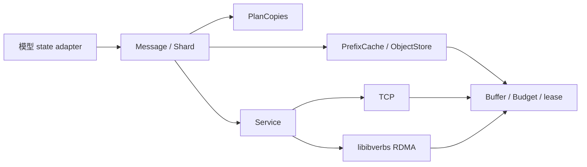

# Fast KV Manager

Fast KV Manager 是独立的 C++17 组件，提供有界的状态传输、缓冲区生命周期管理、逻辑分片规划和不可变前缀缓存。它不依赖 FastLLM、Python、Mooncake、UCX、ZeroMQ 或第三方 RPC 框架。

构建要求 CMake 3.18 或更新版本。基础构建只需要 C++ 标准库、线程和 POSIX socket；CUDA 内存与原生 RDMA 分别是可选功能，依赖 CUDA Runtime 和系统 libibverbs。

## 构建与验证

```bash
cmake -S fastkv -B build-fastkv -DFASTKV_TESTS=ON
cmake --build build-fastkv -j
ctest --test-dir build-fastkv --output-on-failure
```

启用 GPU 内存和 RDMA：

```bash
cmake -S fastkv -B build-fastkv \
  -DFASTKV_CUDA=ON -DFASTKV_RDMA=ON -DFASTKV_TESTS=ON
cmake --build build-fastkv -j
```

嵌入其他 CMake 项目时，可以使用 `add_subdirectory(fastkv)`，然后链接 `fastkv` target。公共头文件为 `fastkv/fastkv.h`；异步主存缓存接口为 `fastkv/host_cache.h`。

诊断工具在每批计时窗口后校验每一个返回的 payload 字节。`seconds` 包含计时批次的连接、分配、注册和传输；`wall_seconds` 还包含预热和客户端校验。`--warmup N` 可在计时前预热 N 次调用；不指定时包含冷启动。校验期间暂停打流，因此这里测的是传输批次带宽，不是包含校验的持续业务吞吐。并发下的 `amortized_call_ms` 是摊销耗时，不是单请求延迟。

`call` 回显 payload，`aggregate_GBps` 统计双向累计字节；`read` 仅发送元数据、单向读取服务端准备好的 payload，适合测量 PD 状态拉取。两端 `read` 的 `--bytes/--buffers/--seed` 必须一致。每次读取创建新的源 buffer 身份，模拟独立状态快照；源数据的准备不计入传输时间。`connections/reused_connections` 分别记录新建和复用连接次数；字节和调用计数包含预热，带宽分子仅包含计时批次。

```bash
# 接收端
build-fastkv/fastkv_probe serve 0.0.0.0:19000 \
  --transport rdma --device 0 --workers 4 --rdma-devices mlx5_0,mlx5_1

# 发送端
build-fastkv/fastkv_probe call receiver:19000 \
  --transport rdma --device 0 --workers 4 --concurrency 8 --bytes 67108864 --count 32 \
  --rdma-devices mlx5_0,mlx5_1
```

## 接口与约束

组件嵌入 P/D 进程，没有独立常驻 daemon 或外部元数据服务。计算拓扑、数据表示和传输各自独立：



`core.cpp` 提供 buffer、codec、预算、对象存储和分片规划；`prefix_cache.cpp` 管理可共享的前缀版本；`network.cpp` 管理有界 RPC 和 TCP 数据通路；`rdma.cpp` 提供可选的原生 RDMA 数据通路。模型 adapter 和 GPU 执行线程在 FastLLM 中，不进入独立组件。

| 接口 | 作用 |
|---|---|
| `Buffer` | Host/CUDA 内存、切片、只读视图，以及 allocation lease。地址复用不会复用 allocation ID。 |
| `Message` | 有界元数据和独立 buffer 列表，不含远端指针或本地分配器对象。 |
| `Service` | 同步 `Call/Start`、异步 `Submit/TrySubmit/StartAsync`、有界工作队列、取消、超时、停止和统计。 |
| `BufferPool` | 有界 Host/CUDA arena 和注册复用；支持每设备物理容量、lease 释放通知与关闭。 |
| `Budget` | RAII 字节或槽位额度；最后一个 lease 释放后归还额度。 |
| `PlanCopies` | 同一逻辑表示下的多维分片交集，支持源副本去重，拒绝覆盖缺口和歧义。 |
| `ObjectStore` | 完整对象的不可变发布、LRU 淘汰、读取 lease；被读取的对象不会提前释放。 |
| `HostCache` | 完整检查点的异步 CPU L2；不可变区域增量备份、pageable 驻留与有界 pinned 暂存、后台恢复、取消、预算与统计。 |
| `PrefixCache` | 命名空间隔离的边界状态缓存；共享不可变数据块，命中前比较完整 token 序列，数据块复用前比较完整字节。 |
| `PrefillRouter` | 根据当前缓存、待计算 token 和处理速度选择 P；本地在途 lease 覆盖远端统计尚未更新的请求，取消/完成后归还。 |

`PrefixCache` 以 64 KiB 数据块共享不同版本的相同 payload；窗口、压缩尾部和循环状态发生变化时保存独立内容。只恢复调用者实际发布过的 token 边界，不推断任意中间位置的模型状态。默认按唯一数据块和 checkpoint 元数据的字节预算限制容量；可选的 `maxEntries` 仅是额外条目上限。容量不足时优先淘汰已有后继的旧版本，再按访问时间淘汰叶子，正在读取的状态受 lease 保护。

命中后按原有 tensor 边界重建只读 `Message`，不改变模型 adapter 或传输协议。这个活动读取副本属于请求的临时内存，不计入驻留缓存预算；同时读取同一 checkpoint 会复用该副本。上述行为用于默认 Host 分块缓存。`storageDevice=-2` 改为保留各 buffer 源设备的独立不可变快照，不读回 CPU、不做 payload 哈希或块去重，命中直接持有 GPU 快照 lease，所有 payload 仍计入同一字节预算。两种模式都不等于 GPU 页池零拷贝或 P/D 增量传输。

`HostCache` 不调用模型对象，不解释编码、量化 scale 或循环状态。`CacheSnapshot` 的 `Message` 描述完整状态，`CachePayload` 按原 buffer 顺序描述无重叠、完整覆盖的 `CacheRegion`。身份非空的区域必须是该命名空间中不可变的同一字节版本；空身份适用于 SWA/SSM 等边界状态。只有调用方实际恢复过的 `Hit` 才可作为 `restoredParent`，且仅 `prefixRange` 区域允许继承，不能混用独立重算产生的数值版本。

`PublishAsync` 要求源 buffer 已就绪、不可变且持有生命周期。队列忙时返回 `false`；后续备份失败保留旧检查点并计入统计。目录只在所有区域复制完成后原子发布。`Find` 固定完整 checkpoint，`ProbeTokens` 只查元数据；`RestoreAsync` 返回后台产生的 future，消费者得到相同 metadata 和 buffer 边界。设备放置由调用者提供。提交返回 `false` 表示暂时的额度/队列压力；不可能满足的目标放置明确报错。取消或丢弃 future 不会提前释放 DMA 中的内存。

`Options.bytes` 约束唯一物理 Host arena 与元数据，读取 lease 仍计费；`inflightBytes` 约束源/目标在途字节，恢复完成后的目标缓冲区继续持有额度到消费者释放。可用 `restoreDeviceBytes` 进一步限制各目标设备。每 worker 每设备的 pinned 暂存上限是 `stagingBytes`，不随 Host 缓存容量增长。采用私有 non-blocking CUDA stream，每轮不同 GPU 的 DMA 同时提交；只等待本 worker 的流，无 `cudaDeviceSynchronize`。目前不自动绑定 NUMA，也不直接写模型页表；详见 [设计与实现边界](docs/l2-cache-design.md)。

命名空间由调用者给出，应覆盖 checkpoint、adapter 布局以及租户/媒体等隔离身份。同一命名空间和完整 token 序列只发布一次；调用者改变计算语义时必须换命名空间。内容哈希仅用于筛选候选：token 完整比较决定前缀命中，payload 完整字节比较决定数据块共享。物理 64 KiB 数据块不是模型的 KV token 页，也不代表能在该处恢复循环或压缩状态。

调用者负责在借用 GPU buffer 前完成生产者的写入，并提供真实的生命周期 owner。`Read`、`Write`、`CopyFrom` 是同步接口。网络接收使用私有 staging 或调用方预留的目标区；传输完成且可见后才交付给调用者。向模型的提交和 GPU graph 的执行由模型拥有者负责。

RDMA 使用 RC QP。Host 数据跨配置的 NIC 分条发送；GPU 数据优先使用 PCIe 路径最近的 NIC，拓扑不可见时使用全部配置的 NIC。不同 buffer 按块交错投递，避免一个 GPU 的大 tensor 阻塞其他 GPU/NIC。注册缓存挂在 allocation lease 上；QP/CQ 先销毁，随后释放在途 buffer 和 MR。协议先交换长度并预留接收额度，再传 payload，最后确认完成。请求失败不会将部分 buffer 发布为可用状态。

协议 v2 在完整请求/回复结束后复用 socket 和 QP，同一连接上的 RPC 串行，不交错消息。空闲服务端连接不占用传输 worker。仍可与 v1 对端逐请求连接；仅在尚未发送应用请求的握手阶段尝试旧版协议。传输错误关闭连接，不重放请求。

`Options.receivePlacement(metadata, sizes)` 可将每个接收 buffer 映射到本地设备；空结果使用 `receiveDevice`，错误长度或设备映射会被拒绝。回调只解析元数据，不操作模型页表。`deviceBufferBytes` 约束每张设备的物理池容量，计入空闲 arena。

接收 staging 按尺寸类别复用内存和 MR；切片及只读视图共享本次使用的 lease，最后一个视图释放后才能归还池。空闲内存不持有在途字节额度。GPU 新快照可复制到注册池，避免反复注册 GPU 内存；已注册或来自公共 `BufferPool` 的 GPU buffer 以及 Host buffer 直接发送。发送池容量为 `min(maxInflightBytes, workers × 512 MiB)`，容量不足时直接注册原始发送 buffer，传输语义不变。池不会预先分配全部容量；存活的接收 buffer 在 Service 关闭后仍有效。

`BufferPool::AcquireBatch` 对整条消息的设备/字节计划一次性预留容量，失败不留下部分 lease，避免多个接收互相持有部分缓冲等待。池优先复用同设备上可容纳请求的最小空闲 arena；CUDA 分配、释放和 MR 注销均在池锁之外执行，释放完成之前仍计入物理容量。网络接收复用这个接口，不再用全局分配锁串行执行 CUDA 操作。

`rdma` 模式不可静默降级。`auto` 允许握手双方协商 TCP/RDMA，但不会在传输中途重放失败的操作。TCP 同时支持 Host 和 CUDA buffer，CUDA 当前经主存分块搬运。RDMA GPU 内存需要驱动提供可用的 peer-memory/GPUDirect 支持；它不是单纯安装 libibverbs 就能保证的能力。

`Service::StartAsync()` 的 handler 只负责提交计算，立即返回由 `std::promise<Message>` 驱动的 future。组件的进度线程检查完成状态，计算等待期间不占用通信 worker；生产者拥有自己的执行线程和停止逻辑。不要返回析构时可能等待线程的 `std::async` future。普通 `Start()` 保留同步 handler 语义。

可选的 `ControlHandler` 仅处理元数据查询，不占用 producer handler 额度；连接数和通信 worker 仍受原有限额约束。回调必须快速返回，不执行 GPU 计算或等待生产者。`PrefixCache::ProbeTokens` 只观察当前元数据，不重建/持有 payload、不刷新 LRU、不计入实际缓存命中；缓存的 `evictions` 单独统计容量淘汰。

`PrefillRouter` 使用 `(max(远端待计算量, 本地在途量) + 本请求未缓存量 + 额外重算量) / 处理速度` 选择目标，同分时轮转。额外重算量是本节点未缓存量减去所有可用节点中的最小未缓存量，抑制为小幅排队收益重复计算大前缀；在途 lease 只记录实际未缓存量，不累计该惩罚项。估计值只决定目标节点，不能代替恢复状态时的完整校验。组件不保存模型指针、租户 token 或网络连接，也不承担跨机计算通信。

`TrySubmit()` 在客户端槽位暂时不足时返回 `false`，保留请求和输出 future，调用者可以稍后重试；其他错误仍抛出异常。可传入共享 `Cancellation` 和准入 lease：取消会中断网络等待，lease 持有至传输退出及 QP 清理完成。仅丢弃 future 不会取消请求。带取消参数的 `StartAsync()` handler 可在对端退出或超时后停止排队任务，并在当前 GPU step 完成后回收计算状态；未完成的生产者仍占用 handler 额度，直到 future 就绪。旧 handler 接口保持兼容。`Metrics` 提供客户端在途槽位、活动 handler、取消数和准入等待次数，额度错误也标明具体资源。

请求发送、请求接收、回复发送、回复接收使用独立工作池，避免握手和回复 ACK 互相等待；每池最多 `workers` 个线程。单向 P/D 角色通常只有两个池执行任务，另外两个空闲；此外每个 Service 有一个进度线程，监听端还有一个 accept 线程。增加 worker 可以并行处理多个 RPC，单个 RPC 的 RDMA 多网卡分条仍由一个 worker 驱动。只有多条独立传输可并行、且 CPU/内存/网卡尚有余量时，增加线程才有收益。

`Service::Stop()` 应由拥有者线程调用，不能从自身 handler 调用。它中断网络等待并等待正在执行的同步 handler 返回；异步 handler 已交回的未完成 promise 不阻止关闭。关闭组件不等于取消调用者的计算，调用者必须另外停止并回收生产者线程。元数据、buffer 数量、payload、在途字节、线程和队列都有上限。

## 生命周期与背压

1. 发送方完成 producer 写入，构造持有 allocation lease 的 `Message`。模型页池仍归模型管理，不能把即将复用的地址当成有效 owner。
2. 接收方校验协议长度并预留 `Budget`，取得私有 staging 或带租约的目标区，只有完整接收后才返回消息。handler 失败或传输异常返回错误，不发布半成品。
3. RDMA 注册与 allocation ID 绑定；完成事件和可见性检查结束后，使用者才可读取数据。TCP 的 CUDA buffer 通过主存分块传输。
4. 模型 adapter 校验 checkpoint、布局和状态边界，再由拥有者线程恢复本地状态。该阶段属于调用者，不由网络工作池执行 GPU 图或修改请求页表。
5. 缓存发布复制为不可变内容。读取 lease 保证淘汰或缓存析构不会让仍在使用的数据失效；最后一个 owner 释放后归还预算和内存。

`maxPayloadBytes` 限制单条消息，`maxInflightBytes` 同时限制在途接收字节及接收池的驻留内存；池容量按 4 KiB（小于 1 MiB）或 2 MiB 类别取整，边界处可能先达到驻留上限。`workers/queueDepth` 限制各传输池的执行与等待队列。服务端额外使用 `maxActiveRequests` 限制已经调用 handler、但尚未完成回复的请求数（0 表示使用 `workers`），与线程数解耦。handler future、已完成但待发送的结果都继续持有此额度；服务端超时会关闭网络，但未完成生产者仍保留准入额度，直到其 future 完成或 Service 关闭，防止超时后无限堆积后台计算。端到端 deadline 从 Submit/accept 开始，包含排队。缓存字节预算只覆盖所核算的缓存状态和数据块，并不代表进程 RSS 上限；索引容器开销、发布时的临时副本、活动命中的连续重建副本和模型 KV 都需要额外预算。网络队列满会返回错误；接收额度或设备池暂时不足时在 deadline 内等待释放，停止服务会唤醒等待者。单条消息超过配置容量直接拒绝，不自动切换内存类型。模型层仍应在发起请求前做自己的准入控制。

独立组件通过 `Options` 和构造参数配置，不引入运行时调试环境变量。可复用的 `fastkv_probe` 是显式运行的诊断程序，不随模型服务启动。

`PrefillRouter` 对已建立的会话归属使用持续过载判定，避免一次合批的队列波动复制长前缀。
`SessionDirectory` 保存有界、带版本的归属提示，可在多个消费者/生产者间传播。
它只影响请求路由，不改变缓存淘汰优先级，不固定 KV，也不提供分布式锁；
缓存恢复仍须校验实际内容和驻留状态。

## 扩展边界

模型的逻辑状态、目标分片、传输和缓存分别独立。新模型提供状态 adapter；新传输实现内部数据传输接口，不应修改模型的 KV 语义。FP8 scale、压缩 tail、循环窗口、线性注意力递归状态等都应当作为有名称、有版本的状态组件处理。不同表示的转换由显式 codec 完成，`PlanCopies` 不会把不同精度当成普通 memcpy。

当前网络是可信内网协议，没有 TLS 或身份鉴权。当前采用静态成员和请求失败语义，不包含分布式共识、故障后自动重算、NVMe 存储后端或跨机 MoE collective。对象存储是进程内组件，不是持久化分布式存储服务。未来 wide-EP 的计算通信与 KV 状态传输应分别接入。

新增传输后端应复用长度校验、预算和 buffer 生命周期规则，再接入握手协商与数据发送/接收，不在模型代码中分支实现 socket 或 RDMA。异构 P/D 先由 adapter 明确定义可交换的表示，再用 `PlanCopies` 计算分片交集；目前模型交接路径使用各自 adapter 的恢复逻辑，尚未把所有模型自动接到通用 reshard 执行器。多个 P 配多个 D 已可配置，多机 wide-EP D 仍需计算层提供分布式执行组，组件本身不启动或编排 collective rank。

FastLLM 的模型接入、部署与目前的模型限制见 [PD 部署文档](../docs/fastkv_pd.md)。

### 接收端预留目标

`Service::TrySubmit` 的可选 `ReceiveTarget` 回调按回复元数据和逻辑 buffer 长度返回目标：每个逻辑 buffer 对应一组有序 `Buffer` span。span 长度之和必须精确等于源长度；接收端在确认接收前校验数量、长度及可写性。调用方负责保留互不重叠的私有区域，不能让模型同时访问它们。

TCP 和 RDMA 共用此接口。接收确认携带 span 长度，发送端据此切分原 buffer 的视图，注册复用仍按底层 allocation 进行；不因页分散而复制源数据。默认不传回调时保留原有 arena 接收方式。分段接收要求两端均支持该接口。

定向接收返回的 `Message.buffers` 是目标 spans 按逻辑 buffer 顺序展开的列表，不再是一块 buffer 对应一个完整 tensor。应用应由自己预留目标的对象负责提交，不能直接将其交给要求 compact tensor 的解码器。`Buffer::WithLease` 可在不改变 allocation ID/MR 的情况下增加页预留租约。租约覆盖 I/O、QP teardown 及返回结果的生命周期；回调不发布活动页表，应用只在 future 成功后提交。
