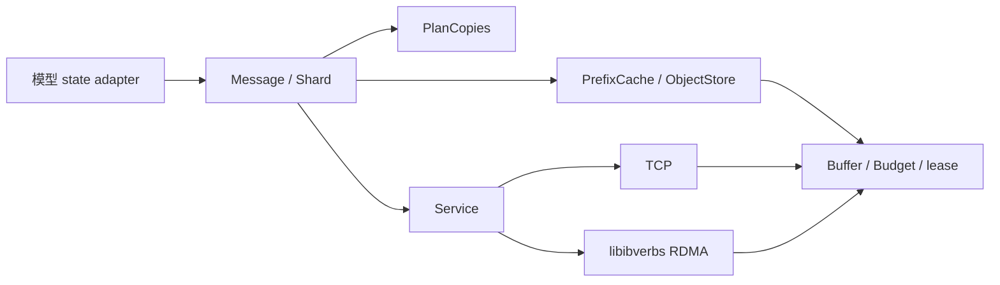

# Fast KV Manager

Fast KV Manager 是独立的 C++17 组件，提供有界的状态传输、缓冲区生命周期管理、逻辑分片规划和不可变前缀缓存。它不依赖 FastLLM、Python、Mooncake、UCX、ZeroMQ 或第三方 RPC 框架。

构建要求 CMake 3.18 或更新版本。基础构建只需要 C++ 标准库、线程和 POSIX socket；CUDA 内存与原生 RDMA 分别是可选功能，依赖 CUDA Runtime 和系统 libibverbs。

## 构建与验证

```bash
cmake -S fastkv -B build-fastkv -DFASTKV_TESTS=ON
cmake --build build-fastkv -j
ctest --test-dir build-fastkv --output-on-failure
```

启用 GPU 内存和 RDMA：

```bash
cmake -S fastkv -B build-fastkv \
  -DFASTKV_CUDA=ON -DFASTKV_RDMA=ON -DFASTKV_TESTS=ON
cmake --build build-fastkv -j
```

嵌入其他 CMake 项目时，可以使用 `add_subdirectory(fastkv)`，然后链接 `fastkv` target。公共头文件为 `fastkv/fastkv.h`。

诊断工具会校验每一个 payload 字节。其耗时包含分配、注册、往返以及 CPU 校验，不能直接当作网络带宽：

```bash
# 接收端
build-fastkv/fastkv_probe serve 0.0.0.0:19000 \
  --transport rdma --device 0 --rdma-devices mlx5_0,mlx5_1

# 发送端
build-fastkv/fastkv_probe call receiver:19000 \
  --transport rdma --device 0 --bytes 67108864 --count 10 \
  --rdma-devices mlx5_0,mlx5_1
```

## 接口与约束

组件嵌入 P/D 进程，没有独立常驻 daemon 或外部元数据服务。计算拓扑、数据表示和传输各自独立：



`core.cpp` 提供 buffer、codec、预算、对象存储和分片规划；`prefix_cache.cpp` 管理可共享的前缀版本；`network.cpp` 管理有界 RPC 和 TCP 数据通路；`rdma.cpp` 提供可选的原生 RDMA 数据通路。模型 adapter 和 GPU 执行线程在 FastLLM 中，不进入独立组件。

| 接口 | 作用 |
|---|---|
| `Buffer` | Host/CUDA 内存、切片、只读视图，以及 allocation lease。地址复用不会复用 allocation ID。 |
| `Message` | 有界元数据和独立 buffer 列表，不含远端指针或本地分配器对象。 |
| `Service` | 同步 `Call`、异步 `Submit`、有界工作队列、超时、停止和统计。 |
| `Budget` | RAII 字节或槽位额度；最后一个 lease 释放后归还额度。 |
| `PlanCopies` | 同一逻辑表示下的多维分片交集，支持源副本去重，拒绝覆盖缺口和歧义。 |
| `ObjectStore` | 完整对象的不可变发布、LRU 淘汰、读取 lease；被读取的对象不会提前释放。 |
| `PrefixCache` | 命名空间隔离的边界状态缓存；共享不可变数据块，命中前比较完整 token 序列，数据块复用前比较完整字节。 |

`PrefixCache` 以 64 KiB 数据块共享不同版本的相同 payload；窗口、压缩尾部和循环状态发生变化时保存独立内容。只恢复调用者实际发布过的 token 边界，不推断任意中间位置的模型状态。默认按唯一数据块和 checkpoint 元数据的字节预算限制容量；可选的 `maxEntries` 仅是额外条目上限。容量不足时优先淘汰已有后继的旧版本，再按访问时间淘汰叶子，正在读取的状态受 lease 保护。

命中后按原有 tensor 边界重建只读 `Message`，不改变模型 adapter 或传输协议。这个活动读取副本属于请求的临时内存，不计入驻留缓存预算；同时读取同一 checkpoint 会复用该副本。当前接入仍需要主存恢复和完整状态传输，共享存储不等于 GPU 页池零拷贝或 P/D 增量传输。

命名空间由调用者给出，应覆盖 checkpoint、adapter 布局以及租户/媒体等隔离身份。同一命名空间和完整 token 序列只发布一次；调用者改变计算语义时必须换命名空间。内容哈希仅用于筛选候选：token 完整比较决定前缀命中，payload 完整字节比较决定数据块共享。物理 64 KiB 数据块不是模型的 KV token 页，也不代表能在该处恢复循环或压缩状态。

调用者负责在借用 GPU buffer 前完成生产者的写入，并提供真实的生命周期 owner。`Read`、`Write`、`CopyFrom` 是同步接口。网络接收使用私有 staging；传输完成且可见后才交付给调用者。向模型的提交和 GPU graph 的执行由模型拥有者负责。

RDMA 使用 RC QP 和多 NIC 分条传输。注册缓存挂在 allocation lease 上；QP/CQ 先销毁，随后释放在途 buffer 和 MR。协议先交换长度并预留接收额度，再传 payload，最后确认完成。请求失败不会将部分 buffer 发布为可用状态。

`rdma` 模式不可静默降级。`auto` 允许握手双方协商 TCP/RDMA，但不会在传输中途重放失败的操作。TCP 同时支持 Host 和 CUDA buffer，CUDA 当前经主存分块搬运。RDMA GPU 内存需要驱动提供可用的 peer-memory/GPUDirect 支持；它不是单纯安装 libibverbs 就能保证的能力。

`Service::Stop()` 应由拥有者线程调用；它中断网络等待并等待 handler 退出，不能从该 Service 自己的 handler 中调用。handler 中的长计算需要自己检查停止标志。元数据、buffer 数量、payload、在途字节、线程和队列都有上限。

## 生命周期与背压

1. 发送方完成 producer 写入，构造持有 allocation lease 的 `Message`。模型页池仍归模型管理，不能把即将复用的地址当成有效 owner。
2. 接收方校验协议长度并预留 `Budget`，分配私有 staging，只有完整接收后才返回消息。handler 失败或传输异常返回错误，不发布半成品。
3. RDMA 注册与 allocation ID 绑定；完成事件和可见性检查结束后，使用者才可读取数据。TCP 的 CUDA buffer 通过主存分块传输。
4. 模型 adapter 校验 checkpoint、布局和状态边界，再由拥有者线程恢复本地状态。该阶段属于调用者，不由网络工作池执行 GPU 图或修改请求页表。
5. 缓存发布复制为不可变内容。读取 lease 保证淘汰或缓存析构不会让仍在使用的数据失效；最后一个 owner 释放后归还预算和内存。

`maxPayloadBytes` 限制单条消息，`maxInflightBytes` 限制接收 staging，`workers/queueDepth` 限制执行与等待队列。缓存字节预算只覆盖所核算的缓存状态和数据块，并不代表进程 RSS 上限；索引容器开销、发布时的临时副本、活动命中的连续重建副本和模型 KV 都需要额外预算。网络队列满或接收额度不足会返回错误，模型层应在发起请求前做自己的准入控制。

独立组件通过 `Options` 和构造参数配置，不引入运行时调试环境变量。可复用的 `fastkv_probe` 是显式运行的诊断程序，不随模型服务启动。

## 扩展边界

模型的逻辑状态、目标分片、传输和缓存分别独立。新模型提供状态 adapter；新传输实现内部数据传输接口，不应修改模型的 KV 语义。FP8 scale、压缩 tail、循环窗口、线性注意力递归状态等都应当作为有名称、有版本的状态组件处理。不同表示的转换由显式 codec 完成，`PlanCopies` 不会把不同精度当成普通 memcpy。

当前网络是可信内网协议，没有 TLS 或身份鉴权。当前采用静态成员和请求失败语义，不包含分布式共识、故障后自动重算、NVMe 存储后端或跨机 MoE collective。对象存储是进程内组件，不是持久化分布式存储服务。未来 wide-EP 的计算通信与 KV 状态传输应分别接入。

新增传输后端应复用长度校验、预算和 buffer 生命周期规则，再接入握手协商与数据发送/接收，不在模型代码中分支实现 socket 或 RDMA。异构 P/D 先由 adapter 明确定义可交换的表示，再用 `PlanCopies` 计算分片交集；目前模型交接路径使用各自 adapter 的恢复逻辑，尚未把所有模型自动接到通用 reshard 执行器。多个 P 配多个 D 已可配置，多机 wide-EP D 仍需计算层提供分布式执行组，组件本身不启动或编排 collective rank。

FastLLM 的模型接入、部署与目前的模型限制见 [PD 部署文档](../docs/fastkv_pd.md)。
